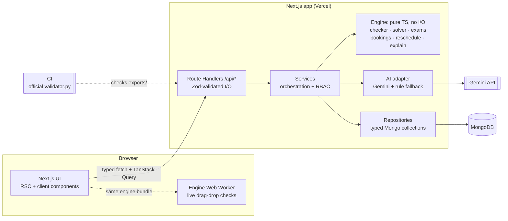

# CIT Nexus: Campus Scheduling & Venue Management (CIT Crunch Week)

A web platform for Chilika Institute of Technology that generates a clash-free weekly timetable, schedules midsem exams, decides Spectra-week (Week 7) venue requests by priority and repairs the timetable after disruptions with minimal moves and admin approval.
Venue requests can be typed in plain English or Hinglish. Every decision comes with a reason, and validity is always checked by a deterministic constraint engine.

> **Status:** foundation build (project scaffold, shared data contracts, UI primitives, tooling). Features land phase by phase; see [Known limitations](#known-limitations).

---

## Architecture



**LLM trust boundary:** user text → Gemini (parse or phrase only) → Zod schema check → engine hard-constraint check → human reviews an editable form → service writes to the DB. Gemini never reaches the database, changes a status, picks a priority category or approves anything. Details: [docs/architecture.md §2](docs/architecture.md#2-system-diagram) and [AI_USAGE.md](AI_USAGE.md).

## Tech stack

| Layer           | Choice                                                                 |
| --------------- | ---------------------------------------------------------------------- |
| Framework       | Next.js 16 (App Router, Route Handlers, `proxy.ts`), React 19          |
| Language        | TypeScript (strict)                                                    |
| UI              | Tailwind CSS v4, shadcn/ui (Radix UI primitives), lucide-react, sonner |
| Client state    | TanStack Query v5, nuqs (URL state), react-hook-form                   |
| Contracts       | Zod 4: one schema per shape, shared by DB, API, forms and export       |
| Database        | MongoDB (Atlas in production, local `mongod` or Docker in development) |
| Auth            | bcryptjs password hashes, `jose`-signed JWT in an httpOnly cookie      |
| AI              | Google Gemini API, behind a Zod-validated adapter with a rule fallback |
| Testing / tools | Vitest, ESLint, Prettier, `tsx`, organisers' `validator.py` (Python 3) |
| Hosting         | Vercel + MongoDB Atlas                                                 |

## Setup

Requirements: **Node.js ≥ 20.9** (see `.nvmrc`), npm, and either a local `mongod` binary or Docker. Python 3.8+ is needed only for `npm run validate`.

```bash
# 1. Install dependencies
npm ci

# 2. Start MongoDB (pick one)
npm run db:start          # local mongod on 127.0.0.1:27017, data in .data/
docker compose up -d      # mongo:7 container on 127.0.0.1:27017

# 3. Configure environment
cp .env.example .env.local   # then fill in AUTH_SECRET (and GEMINI_API_KEY if using AI)

# 4. Run the app
npm run dev
```

Open http://localhost:3000. Health check:

```bash
curl localhost:3000/api/health
```

### Scripts

| Script              | What it does                                                     |
| ------------------- | ---------------------------------------------------------------- |
| `npm run dev`       | Start the dev server on port 3000                                |
| `npm run build`     | Production build                                                 |
| `npm start`         | Serve the production build                                       |
| `npm run lint`      | ESLint                                                           |
| `npm run typecheck` | `tsc --noEmit`                                                   |
| `npm test`          | Vitest (single run); `npm run test:watch` for watch mode         |
| `npm run format`    | Prettier write; `npm run format:check` to check only             |
| `npm run db:start`  | Start a local `mongod` in the background (data in `.data/mongo`) |
| `npm run validate`  | Run the organisers' `validator.py` on the files in `exports/`    |

## Demo accounts

One-click demo-account cards on `/login` arrive with real sign-in (Phase 2); until then use the credentials above.

| Role                   | Email                | Password      | Linked to                                          |
| ---------------------- | -------------------- | ------------- | -------------------------------------------------- |
| Admin                  | `admin@cit.demo`     | `Admin@123`   | Dean's office                                      |
| Department coordinator | `coord.cse@cit.demo` | `Coord@123`   | Department `CSE`                                   |
| Faculty                | `faculty@cit.demo`   | `Faculty@123` | `F06` Dr. Arjun Mehta (CSE, teaches CS202 / CS303) |
| Club representative    | `club@cit.demo`      | `Club@123`    | Dramatics Society                                  |

Nobody can approve their own request. Role permissions: [docs/architecture.md §9](docs/architecture.md#9-auth-and-rbac).

## Validating exports

Exports are produced only by the app (Export button / `/api/export`) and committed exactly as downloaded.

| Command                       | Checks                                                                                                   |
| ----------------------------- | -------------------------------------------------------------------------------------------------------- |
| `npm run validate`            | `exports/schedule.json` against `data/cit_public.json`                                                   |
| `npm run validate -- --after` | `exports/schedule_after.json` with `data/sample_disruption.json` and `exports/schedule.json` as baseline |

Both run the unmodified `CrunchWeek_StarterPack/validator.py` and print hard violations by rule, soft penalty, booking score, priority inversions and moved sessions. CI runs them whenever the export files exist.

## Project structure

```
.
├── src/
│   ├── app/
│   │   ├── page.tsx  login/  signup/  # CIT Nexus landing page, sign-in and access request
│   │   ├── (app)/                   # authenticated shell: dashboard, timetable, rooms,
│   │   │                            # bookings, spectra, approvals, changes, assistant,
│   │   │                            # exams, admin
│   │   └── api/                     # Route Handlers
│   ├── components/
│   │   ├── ui/                      # shadcn/ui primitives
│   │   ├── landing/ auth/ brand/    # CIT Nexus landing sections, auth forms, logo
│   │   ├── layout/ providers/ states/   # app shell, providers, empty/error/loading states
│   │   └── {timetable,booking,approvals,dashboard,assistant}/   # (planned)
│   ├── lib/
│   │   ├── contracts/               # Zod schemas: single source of truth
│   │   ├── api/                     # route helpers: withHandler, parseJsonBody, ok/fail
│   │   ├── engine/                  # (planned) pure TS: checker, solver, exams, bookings, reschedule, explain
│   │   ├── db/                      # Mongo client, typed collections, repositories
│   │   ├── services/                # (planned) use-cases (generate, decide bookings, propose change, …)
│   │   ├── ai/                      # (planned) Gemini client, prompt loader, Hinglish rules, fallbacks
│   │   ├── auth/                    # session, RBAC guards (demo credentials today)
│   │   ├── errors.ts                # ApiError, shared by services and route handlers
│   │   ├── env.ts  dataset.ts  format.ts
│   │   └── api-client.ts            # typed fetch wrapper used by the UI
│   ├── config/                      # nav, roles, demo accounts, semantic chip mapping
│   └── proxy.ts                     # (planned) auth gate (Next.js 16)
├── prompts/                         # versioned prompt files
├── scripts/                         # validate.ts and other CLI scripts
├── data/                            # starter-pack cit_public.json + sample_disruption.json
├── exports/                         # schedule.json, schedule_after.json (from the app)
├── CrunchWeek_StarterPack/          # organisers' starter pack (unmodified)
├── docs/
└── AI_USAGE.md  THIRD_PARTY.md  README.md  .env.example
```

Dependency rule: `app → services → (engine | ai | db) → contracts`. The engine imports only `contracts`. ESLint enforces this (`no-restricted-imports` in `eslint.config.mjs`).

Scripts that import server-only modules (database, env) run with `npx tsx --conditions=react-server scripts/<name>.ts`.

## Documentation

| Doc                                          | Contents                                                           |
| -------------------------------------------- | ------------------------------------------------------------------ |
| [docs/architecture.md](docs/architecture.md) | System design, data contracts, MongoDB schema, API catalogue, RBAC |
| [docs/backend.md](docs/backend.md)           | Features, algorithms, dataset traps, AI layer                      |
| [docs/frontend.md](docs/frontend.md)         | Design system, screens, components, responsive and state handling  |
| [AI_USAGE.md](AI_USAGE.md)                   | AI in the product, AI tools used, prompts, what the LLM may not do |
| [THIRD_PARTY.md](THIRD_PARTY.md)             | Libraries, components, fonts, services and data used               |

## Known limitations

- Deployment link: pending.
- Features are in progress: timetable generation, exams, Spectra decisions, natural-language booking, rescheduling and the assistant land in later builds.
- Validator output for the final exports will be added here once `exports/` is populated.

## Team

| Area                  | Owns                                                               | Member |
| --------------------- | ------------------------------------------------------------------ | ------ |
| Engine                | Constraint checker, solver, exam scheduler, rescheduler, optimiser | TBD    |
| Backend and AI        | Database, auth and RBAC, services, API, booking engine, AI layer   | TBD    |
| Frontend and delivery | UI, design system, deployment, docs, demo video                    | TBD    |
