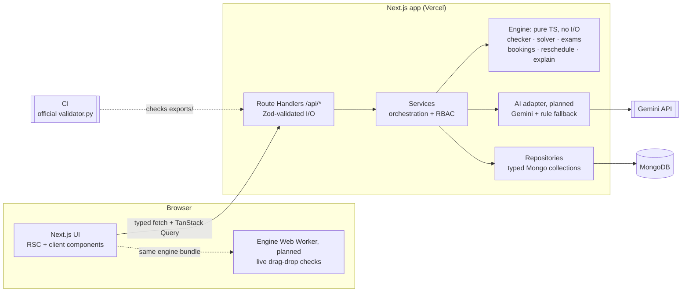

# CIT Nexus: Campus Scheduling & Venue Management (CIT Crunch Week)

A web platform for Chilika Institute of Technology that generates a clash-free weekly timetable, schedules midsem exams, decides Spectra-week (Week 7) venue requests by priority and repairs the timetable after disruptions with minimal moves and admin approval.
Venue requests can be typed in plain English or Hinglish. Every decision comes with a reason, and validity is always checked by a deterministic constraint engine.

> **Status:** Phase 3 backend done: timetable generator, exam scheduler, Spectra booking decisions, `schedule.json` export (0 hard violations, see [Validating](#validating)), on top of the engine checker with exact `validator.py` parity, data layer, auth and read APIs. AI features and rescheduling are pending; features land phase by phase, see [Known limitations](#known-limitations).

---

## Architecture



**LLM trust boundary:** user text → Gemini (parse or phrase only) → Zod schema check → engine hard-constraint check → human reviews an editable form → service writes to the DB. Gemini never reaches the database, changes a status, picks a priority category or approves anything. Details: [docs/architecture.md §2](docs/architecture.md#2-system-diagram) and [AI_USAGE.md](AI_USAGE.md).

## Tech stack

| Layer           | Choice                                                                 |
| --------------- | ---------------------------------------------------------------------- |
| Framework       | Next.js 16 (App Router, Route Handlers, `proxy.ts`), React 19          |
| Language        | TypeScript (strict)                                                    |
| UI              | Tailwind CSS v4, shadcn/ui (Radix UI primitives), lucide-react, sonner |
| Client state    | TanStack Query v5, nuqs (URL state), react-hook-form                   |
| Contracts       | Zod 4: one schema per shape, shared by DB, API, forms and export       |
| Database        | MongoDB (Atlas in production, local `mongod` or Docker in development) |
| Auth            | bcryptjs password hashes, `jose`-signed JWT in an httpOnly cookie      |
| AI (planned)    | Google Gemini API, behind a Zod-validated adapter with a rule fallback |
| Testing / tools | Vitest, ESLint, Prettier, `tsx`, organisers' `validator.py` (Python 3) |
| Hosting         | Vercel + MongoDB Atlas                                                 |

## Setup

Requirements: **Node.js ≥ 20.9** (see `.nvmrc`), npm, and either a local `mongod` binary or Docker. Python 3.8+ is needed only for `npm run validate`.

```bash
# 1. Install dependencies
npm ci

# 2. Start MongoDB (pick one)
npm run db:start          # local mongod on 127.0.0.1:27017, data in .data/
docker compose up -d      # mongo:7 container on 127.0.0.1:27017

# 3. Configure environment
cp .env.example .env.local   # then fill in AUTH_SECRET (and GEMINI_API_KEY if using AI)

# 4. Load the bundled dataset and demo accounts into MONGODB_DB (safe to re-run; it resets the demo data)
npm run seed

# 5. Run the app
npm run dev
```

Open http://localhost:3000 and sign in with a [demo account](#demo-accounts). Health check:

```bash
curl localhost:3000/api/health
```

API reference for the routes that exist today: [docs/api.md](docs/api.md).

### Scripts

| Script              | What it does                                                                                                                                                                               |
| ------------------- | ------------------------------------------------------------------------------------------------------------------------------------------------------------------------------------------ |
| `npm run dev`       | Start the dev server on port 3000                                                                                                                                                          |
| `npm run build`     | Production build                                                                                                                                                                           |
| `npm start`         | Serve the production build                                                                                                                                                                 |
| `npm run lint`      | ESLint                                                                                                                                                                                     |
| `npm run typecheck` | `tsc --noEmit`                                                                                                                                                                             |
| `npm test`          | Vitest (single run); `npm run test:watch` for watch mode                                                                                                                                   |
| `npm run format`    | Prettier write; `npm run format:check` to check only                                                                                                                                       |
| `npm run db:start`  | Start a local `mongod` in the background (data in `.data/mongo`)                                                                                                                           |
| `npm run seed`      | Reset the demo database to `data/cit_public.json` (dataset, demo users, settings), then generate the timetable, exams and Spectra decisions; `-- --stored` keeps the last uploaded dataset |
| `npm run export`    | Download `exports/schedule.json` from a running app (`-- --url http://localhost:3000`) as the demo admin                                                                                   |
| `npm run parity`    | Check our engine against the organisers' `validator.py` (78 cases)                                                                                                                         |
| `npm run validate`  | Run the organisers' `validator.py` on the files in `exports/`                                                                                                                              |

## Demo accounts

Sign in on `/login` with the email and password below. One-click sign-in: the demo-account cards on `/login`, or the API directly, `POST /api/auth/demo-login` with `{"role":"admin"}` (or `department_coordinator`, `faculty`, `club`). Run `npm run seed` first on a new database (demo-login also re-creates a missing demo account). Demo sign-in is on by default; `DEMO_LOGIN_ENABLED=false` turns it off.

```bash
curl -c jar -X POST -H 'content-type: application/json' -d '{"role":"admin"}' localhost:3000/api/auth/demo-login
```

| Role                   | Email                | Password      | Linked to                                          |
| ---------------------- | -------------------- | ------------- | -------------------------------------------------- |
| Admin                  | `admin@cit.demo`     | `Admin@123`   | Dean's office                                      |
| Department coordinator | `coord.cse@cit.demo` | `Coord@123`   | Department `CSE`                                   |
| Faculty                | `faculty@cit.demo`   | `Faculty@123` | `F06` Dr. Arjun Mehta (CSE, teaches CS202 / CS303) |
| Club representative    | `club@cit.demo`      | `Club@123`    | Dramatics Society                                  |

**Reset demo data:** signed in as Admin, `POST /api/admin/reset` restores the bundled starter-pack dataset and the demo accounts, so every judge can start from a clean state (the Admin page's Reset button is not connected to it yet; see [docs/project-status.md](docs/project-status.md)).

Nobody can approve their own request. Self-service sign-up (`/signup`) creates Club Representative accounts only, verified by an emailed code in the same browser; faculty and staff accounts are provisioned. Role permissions: [docs/architecture.md §9](docs/architecture.md#9-auth-and-rbac).

## Validating

Exports are produced only by the app (`GET /api/export`, which `npm run export` calls; the Admin page's Export button is not connected yet and must not be used for submission) and committed exactly as downloaded. The export endpoint refuses to serve a file our validator port finds a hard violation in.

**Current results** (`exports/schedule.json`, produced by the app from the bundled dataset with seed 42; output of `npm run validate`, which runs the unmodified `validator.py`):

```text
Validating exports/schedule.json

Dataset: cit-public-v1   Schedule says: cit-public-v1   Team: CIT Crunch Week
Hard violations: 0  {}
Soft penalty: 3  {'S1': 0, 'S2': 0, 'S3': 0, 'S4': 3, 'S5': 0, 'S6': 0}
Bookings: score 67.0 | approved 22, alternatives 1, rejected 2, session overrides 0, priority inversions 0
Exam soft penalty: 0

PASS: 0 hard violations.
```

| Metric          | Result                                                    | Why it can't be better                                                                                                                                                          |
| --------------- | --------------------------------------------------------- | ------------------------------------------------------------------------------------------------------------------------------------------------------------------------------- |
| Hard violations | **0**                                                     |                                                                                                                                                                                 |
| Soft penalty    | **3** (S4)                                                | Proven lower bound: F08 can't teach MON/WED/FRI and teaches all three CS204 lectures of CSE-2, so two of them share a day (S4 = 3)                                              |
| Booking score   | **67 / 70**                                               | BR-09 (1,200 people) is larger than every venue (the OAT seats 800), so it is rejected; BR-17's window ends at P14, past the last event period (P13), so it gets an alternative |
| Exam penalty    | **0**                                                     |                                                                                                                                                                                 |
| Generation time | about 25 ms (seed 42); never more than the 8 s safety cap | Deterministic: the same seed gives the same timetable (`solver_meta.stopped_by` shows whether the iteration budget or the time cap ended a run)                                 |

The generator is fest-aware: it keeps the auditorium, the CS labs and the compulsory groups free where Week-7 requests need them, so all 22 approvals fit without moving a single class.

| Command                       | Checks                                                                                                   |
| ----------------------------- | -------------------------------------------------------------------------------------------------------- |
| `npm run parity`              | Our engine against `validator.py` on 78 cases (see below); exits 1 on any difference                     |
| `npm run validate`            | `exports/schedule.json` against `data/cit_public.json`                                                   |
| `npm run validate -- --after` | `exports/schedule_after.json` with `data/sample_disruption.json` and `exports/schedule.json` as baseline |

All three run the unmodified `CrunchWeek_StarterPack/validator.py` (Python 3). `parity` scores the same schedules with our TypeScript engine and the official validator and requires identical reports (violations in order, soft penalties, booking stats, exam penalty, stability, warnings). Its 78 cases: the starter-pack example, a synthetic full schedule with and without the fest week, edge cases, 50 seeded mutations, 10 disruption runs (the sample change file and one covering all five change types) and 13 runs on a dataset variant. `--verbose` prints every mismatch. `validate` prints hard violations by rule, soft penalty, booking score, priority inversions and moved sessions. CI runs `parity` on every push and `validate` whenever the export files exist.

## Project structure

```
.
├── src/
│   ├── app/
│   │   ├── page.tsx  login/  signup/  unauthorized/   # CIT Nexus landing, sign-in, sign-up, access denied
│   │   ├── dashboard/  admin/  coordinator/  faculty/  club/   # CIT Nexus role pages (role-gated)
│   │   ├── (app)/                   # app shell: timetable, rooms, bookings, spectra,
│   │   │                            # approvals, changes, assistant, exams
│   │   └── api/                     # Route Handlers: auth, admin, settings, timetable (+ generate,
│   │                                # versions), rooms, exams, spectra, export, validate, dashboard,
│   │                                # health (docs/api.md)
│   ├── components/
│   │   ├── ui/                      # shadcn/ui primitives
│   │   ├── landing/ auth/ brand/    # CIT Nexus landing sections, auth forms, logo
│   │   ├── layout/ providers/ states/ semantic/   # app shell, providers, empty/error/loading states, chips
│   │   └── {timetable,booking,approvals,dashboard,assistant}/   # (planned)
│   ├── lib/
│   │   ├── contracts/               # Zod schemas: single source of truth
│   │   ├── api/                     # route helpers: withHandler, parseJsonBody, parseSearchParams, ok/fail
│   │   ├── engine/                  # pure TS port of validator.py (checker, soft score, bookings, exams,
│   │   │                            # disruption); solver, fest costs, exam scheduler, Spectra decisions;
│   │   │                            # reschedule (planned)
│   │   ├── db/                      # native MongoDB driver (no Mongoose): client, collections, indexes, repos/
│   │   ├── services/                # dataset import, reset (+ generation pipeline), settings, timetable
│   │   │                            # generation + versions, view + what-if check, exams, Spectra, export +
│   │   │                            # validator report, room availability, dashboard, OTP email
│   │   ├── ai/                      # (planned) Gemini client, prompt loader, Hinglish rules, fallbacks
│   │   ├── auth/                    # JWT session cookie, guards, proxy rules, accounts + OTP, rate limits,
│   │   │                            # role labels, demo-user seed
│   │   ├── errors.ts                # ApiError, shared by services and route handlers
│   │   ├── env.ts  dataset.ts  format.ts
│   │   └── api-client.ts            # typed fetch wrapper used by the UI
│   ├── config/                      # nav, roles, demo accounts, semantic chip mapping
│   └── proxy.ts                     # auth gate (Next.js 16): page redirects, API 401, cross-origin 403
├── prompts/                         # versioned prompt files
├── scripts/                         # seed.ts, parity.ts, validate.ts, export.ts
├── data/                            # starter-pack cit_public.json + sample_disruption.json
├── exports/                         # schedule.json, schedule_after.json (from the app)
├── CrunchWeek_StarterPack/          # organisers' starter pack (unmodified)
├── docs/
└── AI_USAGE.md  THIRD_PARTY.md  README.md  .env.example
```

Dependency rule: `app → services → (engine | ai | db) → contracts`. The engine imports only `contracts`. ESLint enforces this (`no-restricted-imports` in `eslint.config.mjs`).

Scripts that import server-only modules (database, env) run with `npx tsx --conditions=react-server scripts/<name>.ts`.

## Documentation

| Doc                                              | Contents                                                                           |
| ------------------------------------------------ | ---------------------------------------------------------------------------------- |
| [docs/architecture.md](docs/architecture.md)     | System design, data contracts, MongoDB schema, API catalogue, RBAC                 |
| [docs/project-status.md](docs/project-status.md) | Plain-language status: what works, what to fix, what's next (frontend and backend) |
| [docs/api.md](docs/api.md)                       | API reference for the implemented routes, with example responses                   |
| [docs/backend.md](docs/backend.md)               | Features, algorithms, dataset traps, AI layer                                      |
| [docs/frontend.md](docs/frontend.md)             | Design system, screens, components, responsive and state handling                  |
| [AI_USAGE.md](AI_USAGE.md)                       | AI in the product, AI tools used, prompts, what the LLM may not do                 |
| [THIRD_PARTY.md](THIRD_PARTY.md)                 | Libraries, components, fonts, services and data used                               |

## Known limitations

- Deployment link: pending.
- Done so far: sign-in, sign-up and roles; dataset import and reset; timetable and room views; what-if checks; dashboard; settings; timetable generation (with live progress), version activation, exam scheduling, Spectra decisions, the `schedule.json` export and the in-app validator report ([docs/api.md](docs/api.md)). Natural-language booking and the AI layer land in Phase 4; change requests, approvals, rescheduling (`schedule_after.json`), the assistant and explanations in Phase 5. Most app screens still show sample data and are being connected to the API ([docs/project-status.md](docs/project-status.md)).
- After a dataset **import**, no timetable is generated automatically: run `POST /api/timetable/generate` with `{"activate": true}` and `POST /api/exams/generate` (a reset does all of this).
- Live drag-and-drop checks run on the server (`POST /api/timetable/check`); the in-browser Web Worker copy of the engine shown in the diagram is planned.
- Google sign-in isn't available: `/api/auth/google` always redirects back to `/login?error=google_unavailable` (no callback yet). Use the demo accounts.
- Sign-up email needs `BREVO_API_KEY` and `BREVO_SENDER_EMAIL`. Without them, local development shows the code on screen and production answers 503.
- Rate limits on sign-in, demo sign-in, sign-up and verification codes are kept in memory per server instance: they reset on restart and each serverless instance counts separately. Client IPs are read from `X-Forwarded-For` only on Vercel; elsewhere all callers share one per-IP counter.

## Team

| Area                  | Owns                                                               | Member |
| --------------------- | ------------------------------------------------------------------ | ------ |
| Engine                | Constraint checker, solver, exam scheduler, rescheduler, optimiser | TBD    |
| Backend and AI        | Database, auth and RBAC, services, API, booking engine, AI layer   | TBD    |
| Frontend and delivery | UI, design system, deployment, docs, demo video                    | TBD    |
