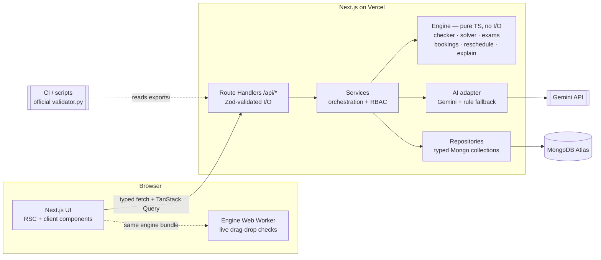
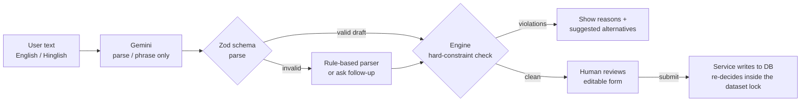
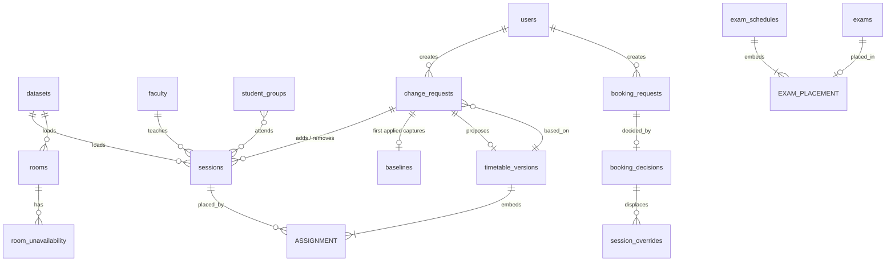
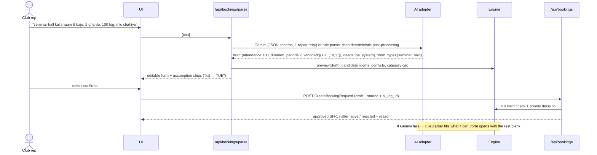
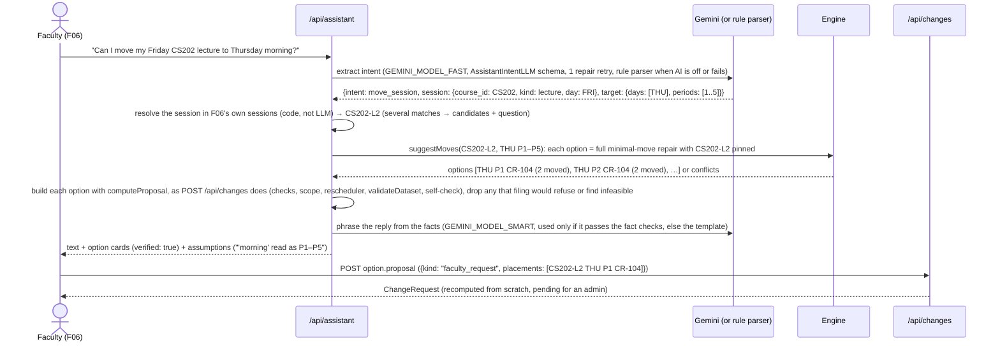
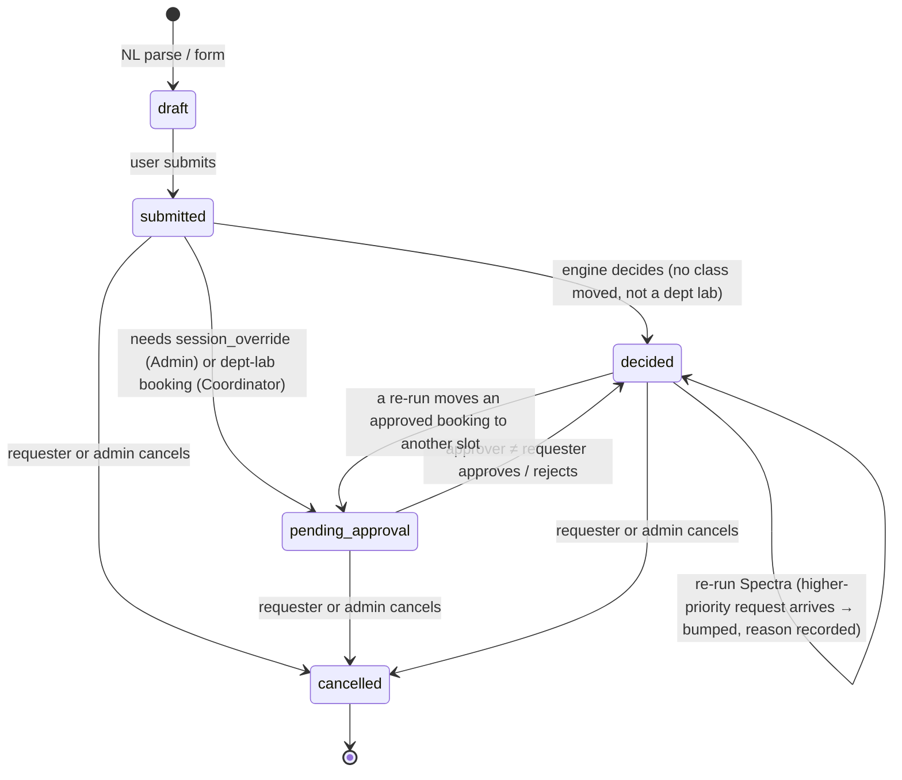
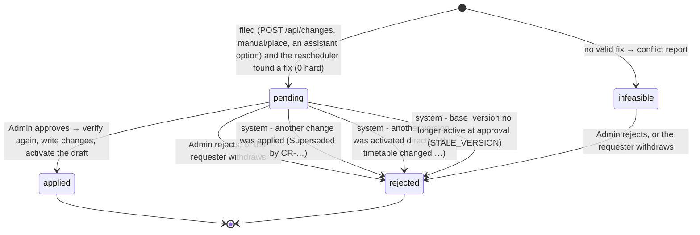

# Architecture & Winning Strategy — CIT Crunch Week

> System design, data contracts, MongoDB schema and the 24-hour plan to win.
> Companion docs: [backend.md](./backend.md) (features, algorithms, AI) · [frontend.md](./frontend.md) (UI plan).

**Stack (fixed):** Next.js (latest stable, TypeScript, App Router) as the full stack · MongoDB Atlas · Google Gemini for the AI layer · Vercel hosting · 3 people · 24 hours.

---

## 1. Overview and non-negotiables

We are building a web platform for Chilika Institute of Technology that:
generates a clash-free weekly timetable (189 sessions) → schedules 41 midsem exams → decides 25 Spectra-week (Week 7) booking requests by priority → turns English/Hinglish requests into editable bookings → repairs the timetable after disruptions with minimal moves and admin approval → explains every decision → imports the starter-pack dataset and exports `schedule.json`.

| #   | Non-negotiable                                | Why                                                  | How we guarantee it                                                                                                            |
| --- | --------------------------------------------- | ---------------------------------------------------- | ------------------------------------------------------------------------------------------------------------------------------ |
| 1   | **0 hard violations** in every export         | −3 marks per violation (Correctness = 25)            | Export endpoint refuses to write if our checker reports any H/B/E violation; CI runs the official `validator.py` on `exports/` |
| 2   | **LLM never decides validity**                | Validity depending on an LLM gives 0 for correctness | LLM output → Zod parse → deterministic engine check → human confirm. LLM has no write access to anything.                      |
| 3   | **Manual booking form works without the LLM** | Judges will turn the AI off or exhaust credits       | `LLM_ENABLED` flag + automatic fallback; form never calls Gemini                                                               |
| 4   | **Exports produced by the app**               | Hand-edited exports mean disqualification            | Exports are only created by `GET /api/export?file=schedule\|schedule_after` (`npm run export [-- --after | --disruption]`; the Admin Export button is pending). Committed as downloaded. |
| 5   | **Read data, never hard-code it**             | Judges reset and load their own change files         | All rules (calendar, lab starts, lunch, priority order, role caps) are read from the dataset document                          |
| 6   | **Nobody approves their own request**         | Explicit rule in §4 of the problem statement         | Server-side check on every approve route (`SELF_APPROVAL`): requests (bookings; faculty, coordinator and assistant change requests) are never approved by their requester. Change files and manual edits are the Admin's own actions (problem statement §2.5, §2.9, §2.10): they still stop at `pending` until the Admin confirms the engine's diff. Only admins approve timetable changes (§8). |

---

## 2. System diagram



### LLM trust boundary



Anything right of `Z` is our code. Gemini can never reach the database, change a status, pick a category or approve anything.

---

## 3. Folder structure (single Next.js app)

```
.
├── src/
│   ├── app/
│   │   ├── page.tsx  login/  signup/  unauthorized/   # CIT Nexus landing, sign-in, sign-up, access denied
│   │   ├── dashboard/  admin/  coordinator/  faculty/  club/   # CIT Nexus role pages (role-gated by proxy.ts)
│   │   ├── (app)/                        # planned route group for the signed-in screens (today they sit at the top level); its layout reads getSessionUser()
│   │   │   ├── timetable/                # group | faculty | room grids
│   │   │   ├── rooms/                    # find a free room
│   │   │   ├── bookings/                 # NL + manual booking
│   │   │   ├── spectra/                  # Week-7 decisions board
│   │   │   ├── approvals/                # inbox + diff review
│   │   │   ├── changes/                  # disruptions & change requests
│   │   │   ├── assistant/                # faculty AI assistant
│   │   │   └── exams/
│   │   └── api/                          # Route Handlers (see §6; live ones in docs/api.md)
│   ├── components/
│   │   ├── ui/                           # shadcn/ui primitives
│   │   ├── layout/ providers/ states/    # app shell, providers, empty/error/loading states
│   │   ├── semantic/                     # StatusBadge, CategoryChip, RuleChip, KindChip
│   │   ├── landing/ auth/ brand/         # CIT Nexus landing sections, auth forms, logo
│   │   └── {timetable,booking,approvals,dashboard,assistant}/   # (planned)
│   ├── config/                           # nav, roles, demo-account display data, semantic chip map
│   ├── workers/                          # (planned) engine Web Worker (drag-and-drop checks)
│   ├── lib/
│   │   ├── contracts/                    # ★ Zod schemas = single source of truth (DashboardSchema in dashboard.ts)
│   │   ├── engine/                       # ★ pure TS, no I/O. validator.py port (instance, checker, soft,
│   │   │                                 #   bookings-check, exams-check, disruption, validate, py, rng);
│   │   │                                 #   solver (model, fest, solver, solver-search), exams (scheduler),
│   │   │                                 #   bookings (+ bookings-text); rescheduler (reschedule, repair,
│   │   │                                 #   conflicts, format), manual (placement check), extra-session, explain
│   │   ├── db/                           # native driver, no Mongoose
│   │   │   ├── client.ts  collections.ts  indexes.ts   # cached client, collection names, every index
│   │   │   ├── locks.ts                  # dataset lock: reset, import, generate, activate, exams, Spectra, booking and change writes (409; booking and change writes wait ≤ 3 s)
│   │   │   ├── repos/                    # reference, datasets, users (+ revoked_sessions), settings, timetable-versions,
│   │   │   │                             #   exam-schedules, booking-decisions, session-overrides, booking-requests,
│   │   │   │                             #   ai-logs, change-requests, baselines, audit-log, meta (timestamps, helpers)
│   │   │   └── models/user.model.ts      # type re-export kept for src/lib/validation.ts
│   │   ├── services/                     # use-cases: dataset (import), reset (+ generation pipeline),
│   │   │                                 #   settings, timetable (generate, activate, versions), timetable-view
│   │   │                                 #   (view + what-if), exams, spectra, export (+ validator report, baseline),
│   │   │                                 #   rooms (availability), dashboard, reference (UI reference data),
│   │   │                                 #   brevo-mail (OTP), llm (AI on/off + client), booking-parse, bookings,
│   │   │                                 #   changes (+ change-proposal, change-scope, change-apply, change-supersede), baseline
│   │   │                                 #   (the schedule.json snapshot and the dataset as loaded), manual,
│   │   │                                 #   assistant, explain
│   │   ├── ai/                           # Gemini client, prompt loader, English/Hinglish rule parsers (bookings,
│   │   │                                 # assistant intents), structured output + repair, post-processing,
│   │   │                                 # parse cache, fact-checked phrasing (explanations, assistant replies)
│   │   ├── auth/
│   │   │   ├── session.ts                # jose HS256 JWT (with jti) in the cit_nexus_session cookie (12 h)
│   │   │   ├── guards.ts                 # requireUser, requireRole (re-read user, check revocation), assertNotSelf
│   │   │   ├── policy.ts                 # assertNotSelf, framework-free (services import it, not guards)
│   │   │   ├── current-user.ts           # userForClaims: verified claims → stored user (revocation, verified)
│   │   │   ├── server-session.ts         # getSessionUser(): signed-in User for Server Components (cached; same checks)
│   │   │   ├── proxy-rules.ts            # pure rules behind src/proxy.ts (no DB access)
│   │   │   ├── accounts.ts               # password and demo sign-in, Club sign-up + OTP, logout revocation
│   │   │   ├── otp.ts  password.ts       # HMAC-hashed 6-digit codes, bcrypt (cost 10)
│   │   │   ├── rate-limit.ts             # in-memory fixed-window limiters
│   │   │   ├── http.ts                   # account-form helpers ({ ok:false, error: string, code } shape)
│   │   │   ├── roles.ts                  # role value ↔ display label (client-safe)
│   │   │   ├── seed.ts  demo-credentials.ts   # demo users; passwords server-only
│   │   │   └── jwt.ts                    # label-role facade for the CIT Nexus role pages
│   │   ├── api/                          # route helpers: withHandler, parseJsonBody, parseSearchParams, ok/fail
│   │   ├── errors.ts                     # ApiError (framework-free, thrown by services)
│   │   ├── env.ts  dataset.ts  format.ts # server env, bundled dataset loader, display formatting
│   │   ├── mock-data.ts  validation.ts   # landing-page illustrative data, client-side form checks
│   │   └── api-client.ts                 # typed fetch wrapper used by the UI
│   └── proxy.ts                          # auth gate (Next.js 16 replacement for middleware.ts)
├── prompts/                              # versioned prompt files (declared in AI_USAGE.md)
├── scripts/                              # seed.ts (reset demo DB), parity.ts (engine vs validator.py),
│                                         # validate.ts (exports, --after), export.ts (downloads /api/export, --after, --disruption),
│                                         # ai-eval.ts (booking-parser and assistant-intent accuracy)
│                                         # (DB scripts: npx tsx --conditions=react-server …)
├── data/                                 # copy of starter-pack cit_public.json + sample_disruption.json
├── exports/                              # schedule.json, schedule_after.json (from the app)
├── docs/
├── AI_USAGE.md  THIRD_PARTY.md  README.md  .env.example
```

**Dependency rule:** `app → services → (engine | ai | db) → contracts`. The engine imports only `contracts`. UI components import `contracts` and `api-client`, never `db` or `services`. Route handlers may import only `getDb`/`pingDb` from the db layer (to hand a `Db` to services), never repositories, the engine or the driver; services never import route helpers or Next.js; the db layer never imports services, auth, api or the engine. Services may use the framework-free `@/lib/auth/policy` and `@/lib/auth/rate-limit`, never the guards, cookies or session modules. ESLint enforces all of this with `no-restricted-imports` (`eslint.config.mjs`). Scripts that import `server-only` modules run with `npx tsx --conditions=react-server`.

---

## 4. Data contracts: one format everywhere

### 4.1 The rule

> **Every shape is defined once as a Zod schema in `src/lib/contracts/`. Everything else is derived from it.**

| Consumer           | How it uses the contract                                                                                               |
| ------------------ | ---------------------------------------------------------------------------------------------------------------------- |
| TypeScript types   | `export type Session = z.infer<typeof SessionSchema>`                                                                  |
| Dataset import     | `DatasetSchema.parse(json)` rejects malformed starter-pack or change files with field-level errors                     |
| MongoDB            | Repositories accept only parsed objects; optional `$jsonSchema` collection validator generated with `z.toJSONSchema()` |
| API                | Every Route Handler does `RequestSchema.parse(body)` and returns `ResponseSchema`-typed data                           |
| Forms              | `react-hook-form` + `zodResolver(BookingDraftSchema)`                                                                  |
| Gemini             | `responseJsonSchema: z.toJSONSchema(BookingDraftLLMSchema)`, then `.parse()` on the reply                              |
| Export             | `ScheduleExportSchema.parse(built)` before download                                                                    |
| Tests and fixtures | Fixtures are typed and parsed, so a schema change breaks tests, not production                                         |

### 4.2 Naming and value conventions (identical in DB, API, UI, export)

| Concept       | Convention                                                                                         | Example                                                                        |
| ------------- | -------------------------------------------------------------------------------------------------- | ------------------------------------------------------------------------------ |
| Field names   | **snake_case, exactly as in `cit_public.json` / `schedule.json`.** No camelCase mapping layer.     | `start_period`, `room_id`, `faculty_id`, `basket_slot`, `mandatory_for_groups` |
| IDs           | Strings from the dataset, used as Mongo `_id` **and** repeated as `id`                             | `"MA101-AB-L1"`, `"AUD"`, `"BR-07"`, `"F07"`, `"Y1-A"`                         |
| Generated IDs | Prefixed, sortable strings                                                                         | `"TT-0007"`, `"CR-0003"`, `"REQ-20270205-0012"`                                |
| Day           | `"MON" \| "TUE" \| "WED" \| "THU" \| "FRI"`; exams add `"SAT"`                                     | `"THU"`                                                                        |
| Period        | integer 1–13 (1–9 teaching, 10–13 events only)                                                     | `6`                                                                            |
| Ranges        | `start_period` + `end_period` **inclusive** for bookings; `start_period` + `duration` for sessions | `{start_period: 10, end_period: 12}` = 18:00–21:00                             |
| Exam slot     | `day` + `session: "AM" \| "PM"`                                                                    | `{day: "SAT", session: "PM"}`                                                  |
| Timestamps    | ISO-8601 strings with `+05:30`                                                                     | `"2027-01-26T09:45:00+05:30"`                                                  |
| Enums         | lower snake_case strings from the dataset                                                          | `"club_event"`, `"lab_cs"`, `"alternative_offered"`                            |

> UI code formats values for display (`P6` → `14:00–15:00`, `THU` → `Thursday`) only in `src/lib/format.ts`. Data is never stored pre-formatted.

### 4.3 Shared enums (`contracts/enums.ts`)

```ts
export const Day = z.enum(["MON", "TUE", "WED", "THU", "FRI"]);
export const ExamDay = z.enum(["MON", "TUE", "WED", "THU", "FRI", "SAT"]);
export const Period = z.number().int().min(1).max(13);
export const TeachingPeriod = z.number().int().min(1).max(9);
export const SessionKind = z.enum(["lecture", "tutorial", "lab"]);
export const RoomType = z.enum([
  "classroom",
  "lecture_hall",
  "auditorium",
  "seminar_hall",
  "outdoor",
  "lab_cs",
  "lab_elec",
  "lab_phy",
  "workshop",
  "lab_civil",
]);
export const Feature = z.enum([
  "projector",
  "ac",
  "pa_system",
  "stage",
  "power_benches",
  "computers",
]);
export const Need = z.union([Feature, z.literal("accessible")]); // booking "needs"
export const RoomUse = z.enum(["lecture", "tutorial", "lab", "exam", "event"]);
export const Category = z.enum([
  "exam",
  "regular_session",
  "institute_event",
  "guest_lecture",
  "department_event",
  "club_event",
]);
export const Role = z.enum([
  "admin",
  "department_coordinator",
  "faculty",
  "club",
]);
export const DecisionStatus = z.enum([
  "approved",
  "rejected",
  "alternative_offered",
]);
export const RequestState = z.enum([
  "draft",
  "submitted",
  "pending_approval",
  "decided",
  "cancelled",
]);
export const ChangeStatus = z.enum([
  "proposing",
  "pending",
  "approved",
  "rejected",
  "infeasible",
  "applied",
]);
export const ExamSession = z.enum(["AM", "PM"]);
```

> Unknown values in judges' change files: enums are `z.enum` for our own writes, but the **import** schemas use `.catch()` / passthrough on non-critical fields (e.g. a new room feature string) so a surprise value doesn't block loading. Critical fields (ids, day, periods) stay strict.

### 4.4 Core schemas (abridged)

```ts
// contracts/dataset.ts: mirrors cit_public.json 1:1
export const RoomSchema = z.object({
  id: z.string(),
  name: z.string(),
  building: z.string(),
  type: RoomType,
  capacity: z.number().int().positive(),
  features: z.array(z.string()),
  accessible: z.boolean(),
  allowed_uses: z.array(RoomUse),
});
export const SessionSchema = z.object({
  id: z.string(),
  course_id: z.string(),
  kind: SessionKind,
  groups: z.array(z.string()).min(1),
  faculty_id: z.string(),
  size: z.number().int().positive(),
  duration: z.number().int().min(1).max(9),
  room_types: z.array(RoomType).min(1),
  needs_accessible: z.boolean(),
  basket_slot: z.string().nullable(),
  fixed_slot: z.object({ day: Day, start_period: TeachingPeriod }).nullable(),
});
export const BookingRequestSchema = z.object({
  id: z.string(),
  submitted_at: z.string(),
  requester: z.string(),
  role: Role,
  department: z.string().nullable().optional(),
  requested_category: Category,
  title: z.string(),
  attendance: z.number().int().positive(),
  duration_periods: z.number().int().min(1),
  windows: z
    .array(
      z.object({
        day: Day,
        from_period: z.number().int(),
        to_period: z.number().int(),
      }),
    )
    .min(1),
  room_types: z.array(RoomType).min(1),
  needs: z.array(z.string()),
  requested_room: z.string().nullable(),
  mandatory_for_groups: z.array(z.string()),
  series_id: z.string().nullable(),
  raw_text: z.string().optional(),
});
// … FacultySchema, StudentGroupSchema, CourseSchema, ExamSchema, RoomUnavailabilitySchema,
//   CancellationSchema, CalendarSchema, DatasetSchema (whole file), DisruptionSchema (changes[])

// contracts/schedule.ts: mirrors schedule.json 1:1
export const AssignmentSchema = z.object({
  session_id: z.string(),
  day: Day,
  start_period: TeachingPeriod,
  room_id: z.string(),
});
export const BookingDecisionSchema = z.object({
  request_id: z.string(),
  status: DecisionStatus,
  day: Day.optional(),
  start_period: Period.optional(),
  end_period: Period.optional(),
  room_id: z.string().optional(),
  reason: z.string(),
});
export const SessionOverrideSchema = AssignmentSchema.extend({
  displaced_by: z.string(),
});
export const ExamPlacementSchema = z.object({
  exam_id: z.string(),
  day: ExamDay,
  session: ExamSession,
  rooms: z.array(z.string()).min(1),
});
export const ScheduleExportSchema = z.object({
  team: z.string(),
  dataset_id: z.string(),
  sessions: z.array(AssignmentSchema),
  fest_week: z.object({
    bookings: z.array(BookingDecisionSchema),
    session_overrides: z.array(SessionOverrideSchema),
  }),
  exams: z.array(ExamPlacementSchema),
});
// ScheduleAfterExportSchema = the same with `fest_week` and `exams` optional (validator.py allows both).
```

> **Import tolerance.** Dataset and change-file schemas are `z.looseObject` (unknown keys kept), apply the validator's own defaults (e.g. `max_hours_per_day` 4, `basket_slot`/`fixed_slot` null), and accept free strings wherever `validator.py` does (room types, booking roles/categories, preference types, change-file days). Our own records (users, versions, decisions, change requests) use strict schemas.

### 4.5 API envelope and error codes

```ts
type ApiOk<T> = { ok: true; data: T };
type ApiErr = {
  ok: false;
  error: { code: ErrorCode; message: string; details?: unknown };
};
```

| `code`                          | HTTP      | When                                                                                                                                                      |
| ------------------------------- | --------- | --------------------------------------------------------------------------------------------------------------------------------------------------------- |
| `VALIDATION_ERROR`              | 400       | Zod parse failed (`details` = flattened issues); a change request over `REQUEST_LIMITS`, not fitting its kind or naming unknown ids (`details` = `PathIssue[]`, `[{path, message}]` with paths like `changes[0].faculty_id`, at most 20) |
| `UNAUTHENTICATED` / `FORBIDDEN` | 401 / 403 | No session / role not allowed                                                                                                                             |
| `SELF_APPROVAL`                 | 403       | Approver is the requester (bookings; change requests, except an admin's own change file or manual edit, see §8)                                         |
| `HARD_CONSTRAINT`               | 409       | Engine found violations (`details` = `Violation[]`, H1–H14; the export gate adds B1–B3 / E1–E2)                                                           |
| `INFEASIBLE`                    | 422       | No valid schedule exists (`details` = `{unplaced, violations, issues}` for generation / exams). A change with no valid fix is not an error: it is stored as an `infeasible` change request with its conflict report. |
| `NOT_FOUND`                     | 404       | Unknown id                                                                                                                                                |
| `STALE_VERSION`                 | 409       | Timetable built for another dataset; a change proposal built on a timetable that is no longer active (the proposal is rejected)                         |
| `LLM_UNAVAILABLE`               | 503       | Reserved; not returned today: when Gemini fails the parse answers with the rule parser (`source: "rules"`, `fallback_reason`). Never blocks a booking.   |
| `INTERNAL_ERROR`                | 500       | Unhandled error, or a server-side schema failure (bare `ZodError`). Generic message; details never exposed.                                               |
| `CONFLICT`                      | 409       | Another reset, import, schedule run, booking or change write holds the dataset lock; Spectra decisions missing at export; an export file that needs an applied change (`schedule_after`, `disruption`); a change request that isn't pending, or 20 open ones already; the first change approval while `schedule.json` isn't exportable; activating a change request's draft directly; a sign-up for this email is pending in another browser |
| `EMAIL_TAKEN`                   | 409       | Sign-up with an email a verified account already uses                                                                                                     |
| `RATE_LIMITED`                  | 429       | Too many attempts (`details.retry_after_seconds` + `Retry-After` header)                                                                                  |
| `MAIL_UNAVAILABLE`              | 503       | The sign-up code can't be emailed (mail not configured, Brevo failed, global hourly cap)                                                                  |

Request bodies must be `application/json` (else `VALIDATION_ERROR`) and are capped at 1 MB by default. The four account-form routes (`login`, `signup`, `verify-otp`, `resend-otp`) answer errors as `{ ok: false, error: "message", code, details? }` for the CIT Nexus forms ([api.md](./api.md#response-shapes)).

`Violation` shape is shared by the engine, API and UI, and mirrors the validator output:
`{ rule: "H4", where: "timetable" | "fest_week" | "exams", detail: string, refs: { session_ids?, room_id?, day?, periods?, request_id?, exam_id? } }`.

---

## 5. MongoDB schema

**Driver:** native `mongodb` with typed collections (`db.collection<SessionDoc>("sessions")`). There's no Mongoose because Zod already owns the schema. The client is cached on `globalThis` for serverless.

**Doc type rule:** `type XDoc = X & { _id: string; origin?: Origin; created_at: string; updated_at: string }` where `_id === id`. Repositories strip `_id` and Mongo-only metadata before returning DTOs, so **the API DTO is the contract type**.

### 5.1 Collections overview



### 5.2 Reference data (mirrors the starter pack)

All fields are exactly as in `cit_public.json`, plus `_id` (= `id`), `origin: "dataset" | "disruption" | "manual"`, `seq` (position in the source file, so exports keep file order; records an applied change request adds get the next `seq` and `origin: "disruption"`), `created_at`, `updated_at`. After every approval the stored dataset equals `applyDisruption(loaded file, applied changes in apply order)`, which is what `getActiveDataset` returns. Timestamps are ISO strings (§4.2) except TTL and lock fields (`expires_at`, `unverified_expires_at`, `acquired_at`), which are BSON Dates because MongoDB TTL indexes require them.

| Collection            | Source key              | Extra fields                                                                                                                                                                                                                                                                                                                                                                                                              | Indexes                                                     |
| --------------------- | ----------------------- | ------------------------------------------------------------------------------------------------------------------------------------------------------------------------------------------------------------------------------------------------------------------------------------------------------------------------------------------------------------------------------------------------------------------------- | ----------------------------------------------------------- |
| `datasets`            | whole file meta         | `_id` = `dataset_id`, `institute`, `calendar`, `priority_order`, `role_category_cap`, `loaded_at`, `source: "bundled" \| "upload"`, `raw` (original JSON for reset)                                                                                                                                                                                                                                                       | —                                                           |
| `rooms`               | `rooms[]`               | `department` (derived for labs: `lab_cs→CSE`, `lab_elec→ECE`, `workshop→ME`, `lab_civil→CE`, `lab_phy→PH`)                                                                                                                                                                                                                                                                                                                | `type`, `capacity`                                          |
| `room_unavailability` | `room_unavailability[]` | `_id` = `${room_id}:${day}:${hash}`; a closure from an applied change: `_id` = `${CR}:${room_id}:${day}:${n}` with `change_request_id` (one document per closed day, appended)  | `{room_id, day}`                                            |
| `faculty`             | `faculty[]`             | `user_id?`; `change_request_id?` on a member added by an applied change (`faculty_unavailable` replaces the member's `unavailable` list in place)  | `department`                                                |
| `student_groups`      | `student_groups[]`      | —                                                                                                                                                                                                                                                                                                                                                                                                                         | `department, year`                                          |
| `courses`             | `courses[]`             | —                                                                                                                                                                                                                                                                                                                                                                                                                         | —                                                           |
| `sessions`            | `sessions[]`            | `removed: boolean` (soft-delete so diffs stay explainable), `removed_by?` (the change request that removed it), `change_request_id?` (the one that added it)  | `faculty_id`, `groups`, `basket_slot`                       |
| `exams`               | `exams[]`               | —                                                                                                                                                                                                                                                                                                                                                                                                                         | `groups`                                                    |
| `booking_requests`    | `booking_requests[]`    | `state: RequestState`, `source: "dataset" \| "nl" \| "form"`, `created_by` (user id, null for dataset), `ai_meta?: { model, prompt_id, assumptions[], follow_up?, log_id }`, `approval?: { approved_by, approved_at, room_id, day, start_period, end_period }` (an approver accepted this exact slot), `rejection?: { rejected_by, rejected_at, comment }`. Live requests get ids `REQ-0001…` (series share `series_id`). | `state`, `created_by`, `submitted_at`, `{"windows.day": 1}` |
| `cancellations`       | `cancellations[]`       | —                                                                                                                                                                                                                                                                                                                                                                                                                         | `request_id` (unique)                                       |

> **Dataset document stays the authority for rules.** `calendar.lab_start_periods`, `calendar.lunch.after_period`, `calendar.event_only_periods`, `calendar.exam_week`, `priority_order` and `role_category_cap` are read from `datasets`, never hard-coded.

### 5.3 Working state

**`timetable_versions`**: one doc per generated or approved timetable. Assignments are embedded because they're always read together (189 rows, about 15 KB).

```json
{
  "_id": "TT-0003",
  "dataset_id": "cit-public-v1",
  "status": "active", // draft | active | superseded
  "source": "reschedule", // generate | reschedule | manual
  "parent_version": "TT-0002",
  "change_request_id": "CR-0001",
  "assignments": [
    {
      "session_id": "MA101-AB-L1",
      "day": "MON",
      "start_period": 2,
      "room_id": "LH-1"
    }
  ],
  "hard_violation_count": 0,
  "soft_penalty": {
    "S1": 0,
    "S2": 4,
    "S3": 0,
    "S4": 0,
    "S5": 6,
    "S6": 2,
    "total": 12
  },
  "solver_meta": {
    "seed": 42,
    "ms": 3810,
    "iterations": 120000,
    "algorithm": "greedy+repair+SA"
  },
  "created_by": "u_admin",
  "created_at": "2027-02-05T10:00:00+05:30"
}
```

Indexes: `{status: 1}` (partial unique on `status: "active"`, so only one active version), `{created_at: -1}`.

A change request's proposal is a `draft` with `source: "reschedule"` (or `"manual"` for a manual edit), `parent_version` = the base and `change_request_id` set. Such a draft becomes active only by approving its request (`POST /api/timetable/versions/:id/activate` answers `409 CONFLICT`), is deleted when the request is rejected, and is never pruned while the request is `pending` (it doesn't count toward the 20 kept inactive versions).

**`exam_schedules`**: same pattern (`_id: "EXS-0001"`, `status`, `exams: ExamPlacement[]`, `penalty`).

**`booking_decisions`**: one per request. It's the export shape plus metadata.

```json
{
  "_id": "BR-07",
  "request_id": "BR-07",
  "status": "approved",
  "day": "THU",
  "start_period": 10,
  "end_period": 12,
  "room_id": "AUD",
  "reason": "SH-1 is held by Quiz Club (BR-06, submitted earlier, same priority). AUD has stage + PA and is free inside your window.",
  "reason_code": "ROOM_SWAPPED_IN_WINDOW",
  "effective_category": "club_event",
  "category_capped": false,
  "requires_admin_approval": false,
  "auto": true,
  "decided_by": "engine",
  "approved_by": null,
  "timetable_version": "TT-0003",
  "decided_at": "2027-02-05T10:02:00+05:30"
}
```

Indexes: `{status: 1}`, `{room_id: 1, day: 1}`, `{timetable_version: 1}`. `approved_by` is `null` for engine decisions; for a dataset decision that moves sessions it is the admin whose run or activation applied the moves (kept across later non-admin runs only while the slot and the moved sessions are unchanged); for a live booking it is the approver (admin, or the lab's coordinator) who accepted that exact slot. `decided_by` is `"engine"`, or the approver's id for `REJ_BY_APPROVER`. `facts` holds the engine's structured facts (`BookingFactsSchema`, or `ApproverRejectionFactsSchema` for an approver's rejection); explanations are phrased from them. Decisions are re-computed for the active version on every activation, `POST /api/spectra/run`, and every booking submit, cancel and approval decision (one set at a time: `_id = request_id`, written by upsert then removal of the rest, so readers never see an empty set). Cancelled live requests get no decision.

**`session_overrides`**: Week-7-only moves caused by an approved institute event (`_id = session_id`, `session_id, day, start_period, room_id, displaced_by, approved_by, timetable_version`). Indexes: `{displaced_by: 1}`, `{timetable_version: 1}`.

**`change_requests`**: every change file, unavailability notice, faculty request or manual placement becomes a proposal (`ChangeRequestSchema`, `contracts/change.ts`). The engine's proposal is stored on the request itself, so the list, the detail, the diff view and the explanation all read one document. As stored after `POST /api/changes` with `data/sample_disruption.json` (trimmed):

```json
{
  "_id": "CR-0001",
  "kind": "disruption", // disruption | unavailability | faculty_request | manual_edit
  "requested_by": "u_admin",
  "requested_by_role": "admin", // the role when filed; decides SELF_APPROVAL later
  "changes": [
    {
      "type": "faculty_unavailable",
      "faculty_id": "F07",
      "days": ["MON"],
      "periods": [1, 2, 3, 4, 5, 6, 7, 8, 9],
      "reason": "Conference travel every Monday for the rest of the semester"
    }
    // … room_unavailable CR-102, add_session CS202-T2
  ],
  "placements": [], // Assignment[]: sessions pinned exactly (manual placement, assistant options)
  "description": "Practice disruption for the public dataset. …",
  "nl_prompt": null, // the assistant message an option came from (returned only to the requester and admins)
  "base_version": "TT-0001",
  "proposed_version": "TT-0002", // draft timetable_versions doc; null when infeasible
  "status": "pending", // pending | infeasible | applied | rejected
  "feasible": true,
  "title": "F07 unavailable MON · CR-102 closed MON–FRI · add CS202-T2",
  "warnings": [],
  "diff": [
    {
      "session_id": "MA101-A-T1",
      "from": { "day": "WED", "start_period": 2, "room_id": "CR-102" },
      "to": { "day": "WED", "start_period": 2, "room_id": "LH-3" },
      "move": "room_only", // room_only | time_only | time_and_room | added | removed
      "cause": "broken", // broken | evicted | requested | added | removed
      "rules": ["H8"],
      "displaced_by": null, // the session that needed this slot (evicted)
      "reason": "CR-102 closed MON–FRI P1–P9 (Water leak, …); same time, now in LH-3"
    }
    // … 8 more room-only moves, then CS202-T2 added at MON P7 in CR-103
  ],
  "moved_count": 9, // validator stability semantics, against base_version
  "time_changed": 0,
  "room_only_changed": 9,
  "soft_penalty": { "S1": 0, "S2": 0, "S3": 0, "S4": 3, "S5": 0, "S6": 0, "total": 3 },
  "soft_delta": 0,
  "hard_violation_count": 0,
  "conflicts": [], // ConflictEntry[] when infeasible: {session_id, blocking[{rule, count, detail}], contradictions[], summary}
  "scope": {
    "session_ids": ["MA101-A-T1", "…", "CS202-T2"],
    "faculty_ids": ["F01", "F02", "F06", "F07", "F19", "F22", "F36"],
    "group_ids": ["CSE-2", "Y1-A", "Y1-B", "Y1-C", "Y1-D"],
    "room_ids": ["CR-102", "CR-103", "CR-201", "LH-3"],
    "departments": ["CSE", "HSS", "MA", "PH"]
  },
  "engine": { "broken": 10, "evictions": 0, "depth": 0, "nodes": 148, "ms": 19, "stopped_by": "complete", "algorithm": "minimal-move repair (room, time, ejection chains ≤ 3)" },
  "baseline_stability": null, // {sessions_moved, time_changed, room_only_changed} against the baseline schedule.json once a change is applied; null before (moved_count equals it then) and when infeasible
  "approved_by": null, // set on applied
  "decided_by": null, // the admin, the withdrawing requester, or "system" (stale, superseded)
  "decided_at": null,
  "comment": null, // the decider's comment, "Superseded by CR-0004", or why it went stale ("The timetable changed (TT-0003 is active now); file it again.")
  // "applied_seq": Mongo-only, added when applied: the apply order (the exported change file follows it)
  "created_at": "2026-11-01T03:54:40+05:30",
  "updated_at": "2026-11-01T03:54:41+05:30"
}
```

The `changes[]` items use the **exact starter-pack disruption format** (`faculty_unavailable`, `room_unavailable`, `add_faculty`, `add_session`, `remove_session`), so an uploaded change file, a form and the AI assistant all produce the same object. Before parsing, `changes[]` and `placements[]` are checked against `REQUEST_LIMITS` (ids ≤ 64 characters, other strings ≤ 500, nesting ≤ 6, no `$`/`.`/NUL field names and none of the stored records' own fields such as `_id` or `seq`; full list in [api.md](./api.md#request-limits)), so a request can't store huge or oddly keyed values. Indexes: `{status: 1}`, `{requested_by: 1}`, `{base_version: 1, status: 1}` (pending proposals built on one version), `{"scope.departments": 1}` and `{"scope.faculty_ids": 1}` (the list's visibility filter, applied in the query as an `$or` on requester, department and faculty id), `{created_at: -1}` (newest first). The ids are `CR-0001…`.

**Applied changes live in the reference data.** Approval writes a request's `changes` into the reference collections (§5.2: appended documents with `origin: "disruption"` and `change_request_id`, soft-removed sessions with `removed_by`, faculty `unavailable` lists replaced), so the stored dataset equals `applyDisruption(before, changes)` and every later run (generation, Spectra, the next change) sees the changed data. Mongo here has no multi-collection transactions (standalone locally), so each write is snapshotted first and every insert recorded, and an approval ends either fully applied or fully rolled back (§7.3).

**`baselines`** (singleton `_id: "schedule"`): `{ schedule: ScheduleExport, version_id, dataset_id, change_request_id, captured_at, captured_by }`, i.e. `schedule.json` exactly as it stood just before the first change request was applied. Captured by that approval, and only if `schedule.json` passes the export gate then (0 hard violations, exams included, and a decision for every dataset request; otherwise the approval is a `409 CONFLICT` and the request stays pending). Removed again if the approval rolls back. From then on `GET /api/export?file=schedule` serves this snapshot (checked against `datasets.raw`, the dataset as loaded) and `file=schedule_after` the live timetable, so the pair is exactly what `validator.py --disruption … --baseline schedule.json` compares. Reset and import clear it.

**`users`**

```json
{
  "_id": "u_coord_cse",
  "email": "coord.cse@cit.demo",
  "name": "CSE Coordinator",
  "role": "department_coordinator",
  "department": "CSE",
  "faculty_id": null,
  "club": null,
  "password_hash": "<bcrypt>",
  "is_verified": true,
  "otp_hash": null, "otp_expires_at": null, "otp_attempts": 0,
  "pending_nonce_hash": null,
  "unverified_expires_at": null,
  "google_id": null
}
```
Indexes: unique `email`; partial TTL on `unverified_expires_at` (unverified sign-ups expire after 24 h). Demo accounts are seeded verified (`seedDemoUsers`); self sign-up creates Club accounts only.

**`revoked_sessions`**: `{ _id: <jti>, expires_at }` with a TTL index. Logout revokes only that token; API guards check it and re-read the user on every request, and so does `getSessionUser()` (`src/lib/auth/server-session.ts`) for Server Components. A page whose session is rejected goes to `GET /api/auth/session-expired`, which clears the cookie before `/login` (avoiding a proxy redirect loop).

**`locks`**: `{ _id: "dataset", token, acquired_at, expires_at }`. Single-flight lock taken by reset, import, generation, activation, exam generation, Spectra runs, booking writes and change writes (propose, approve, reject; a concurrent call gets 409 `CONFLICT`; booking and change writes retry for up to 3 s first); a streamed generation holds it from before the stream opens until the run ends. It expires after 75 s (just above Vercel's 60 s route cap) so a crashed request can't wedge it.

**`settings`** (singleton `_id: "app"`): `team` (defaults to `TEAM_NAME`; the export reads `settings.team`), `priority_order` (editable copy for the admin's priority editor, defaults to the dataset's; **every decision and the parse preview use `datasets.priority_order`**, because the official validator ranks priorities and inversions with the dataset's order), `llm_enabled`, `reference_date` (what "today/kal" resolves against, defaulting to the Monday before Week 7), `solver_seed`.

**`audit_log`**: `{ actor, action, entity, entity_id, before?, after?, at }`. Every approve/reject/apply/reset is logged; change requests log `propose`, `approve`, `apply`, `reject` and `supersede`.

**`ai_logs`**: `{ _id: "AI-…", feature: "parse_booking" | "assistant" | "explain", source: "llm" | "rules" | "template", model, prompt_id, input, output_raw, parsed_ok, repaired, cached, fallback_reason, assumptions, follow_up, engine_verdict, latency_ms, user_id, at }`: one per parse (including rule-parser fallbacks and cache hits, flagged `cached`), one per assistant turn (`prompt_id: "assistant_intent.v1"`, with the engine's verdict such as `options:3` or `refused`) and one per model-phrased explanation or assistant reply. A submitted booking's AI provenance copies `assumptions`/`follow_up` from here, never from the request body. Entries expire after 30 days (TTL index). This backs the AI_USAGE declarations and `npm run ai-eval`.

### 5.4 Mongo ↔ API ↔ Export mapping (proof of no drift)

| Concept           | Mongo field                                                                        | API DTO field                              | `schedule.json` field                   |
| ----------------- | ---------------------------------------------------------------------------------- | ------------------------------------------ | --------------------------------------- |
| Session placement | `timetable_versions.assignments[].{session_id,day,start_period,room_id}`           | same                                       | `sessions[]` same                       |
| Booking decision  | `booking_decisions.{request_id,status,day,start_period,end_period,room_id,reason}` | same + `reason_code`, `effective_category` | `fest_week.bookings[]` (first 7 fields) |
| Week-7 override   | `session_overrides.{session_id,day,start_period,room_id,displaced_by}`             | same                                       | `fest_week.session_overrides[]` same    |
| Exam placement    | `exam_schedules.exams[].{exam_id,day,session,rooms}`                               | same                                       | `exams[]` same                          |

The exporter is a **projection** (`pick`), not a transformation, so there's nothing that can drift.

### 5.5 Reset and import

- **Reset demo data** (Admin, `POST /api/admin/reset` or `npm run seed`): clear the working collections and settings, load the bundled `data/cit_public.json` (default) or, with `{"from":"stored"}` / `--stored`, re-import the last upload from `datasets.raw`; ensure indexes, re-seed the demo users, write default settings. Then `postResetPipeline` (`src/lib/services/reset.ts`) generates a timetable with `settings.solver_seed`, activates it (which runs Spectra decisions), and schedules exams, all inside the same lock. An infeasible solve leaves `timetable_version: null` instead of failing the reset. Target: under 15 s.
- **Import** (`POST /api/admin/dataset`) accepts `cit_public.json`-shaped JSON (full replace). The whole file is validated with Zod before any write, including dangling references (sessions → faculty / groups / courses, exams → groups, room unavailability → rooms, mandatory groups, cancellations → requests; an unknown `requested_room` is allowed), and the UI shows `{ path, message }` issues. Import clears timetable versions, exam schedules, decisions, overrides, change requests and the export baseline (and, by replacing the reference collections, everything applied changes wrote), and resets the saved priority order to the new dataset's; reset clears the same.
- **Change files** (starter-pack disruption format) are not imported: they are posted to `POST /api/changes` exactly as they are (`kind` defaults to `disruption`; the file's `id` is accepted and ignored) and become a `change_request` (`pending` with a draft timetable, or `infeasible` with a conflict report). Only an admin's approval writes them into the reference data (§5.3). A change file written for another dataset is accepted with a warning; unknown ids are a `400` with `{path, message}` issues.
- Reset, import, every schedule run, booking write and change write share one dataset lock (`src/lib/db/locks.ts`, `locks` collection, 75 s expiry); an overlapping call gets `409 CONFLICT`. Timetable versions and exam schedules keep the active one plus the 20 newest inactive ones.

---

## 6. API catalogue

All routes live under `src/app/api/`. Request and response bodies are the Zod contracts above. "Roles" = who may call it ("public" = no session; "any" = any signed-in role). **Status:** ✅ = implemented (details and real examples in [api.md](./api.md)); — = not available. Every planned route is built at the end of Phase 5 except Google sign-in (`/api/auth/google` always redirects; §9).

| Route                                                                 | Method             | Roles                                                      | Request → Response                                                                                                                                                                                                      | Status  |
| --------------------------------------------------------------------- | ------------------ | ---------------------------------------------------------- | ----------------------------------------------------------------------------------------------------------------------------------------------------------------------------------------------------------------------- | :-----: |
| `/api/health`                                                         | GET                | public                                                     | → `{status, db, dataset_id, time}`                                                                                                                                                                                      |   ✅    |
| `/api/auth/demo-login`                                                | POST               | public                                                     | `{role}` (value or label) → `User` + session cookie                                                                                                                                                                     |   ✅    |
| `/api/auth/login`                                                     | POST               | public                                                     | `{email, password}` → `User` + cookie; `403` + `requiresOtp` for an unverified sign-up                                                                                                                                  |   ✅    |
| `/api/auth/logout` · `/me`                                            | POST / GET         | any                                                        | → `null` (token revoked, cookie cleared) · → current `User` (`401` when signed out)                                                                                                                                     |   ✅    |
| `/api/auth/signup`                                                    | POST               | public                                                     | sign-up form (Club only) → `{email}` + pending cookie; `409 CONFLICT` if pending elsewhere                                                                                                                              |   ✅    |
| `/api/auth/verify-otp` · `/resend-otp`                                | POST               | public                                                     | `{email, otp}` → `User` + cookie · `{email}` → `null`                                                                                                                                                                   |   ✅    |
| `/api/auth/google`                                                    | GET                | public                                                     | always `302` → `/login?error=google_unavailable` (no callback, `state` or PKCE yet)                                                                                                                                     |    —    |
| `/api/auth/session-expired`                                           | GET                | public                                                     | clears the session cookie → `303 /login?redirect=<safe path>` (for rejected sessions whose cookie is still signed)                                                                                                      |   ✅    |
| `/api/admin/reset`                                                    | POST               | admin                                                      | `{from?: "bundled"\|"stored"}` (default bundled) → `ResetReport`; then generates + activates a timetable, schedules exams and runs Spectra; `409` if busy                                                               |   ✅    |
| `/api/admin/dataset`                                                  | POST (JSON ≤ 2 MB) | admin                                                      | `Dataset` (refs checked) → `ImportReport` (counts, cleared working state); `409` if busy                                                                                                                                |   ✅    |
| `/api/timetable/generate`                                             | POST (JSON or SSE) | admin                                                      | `{seed?, time_budget_ms?, activate?}` → `GenerateTimetableResult` (draft unless `activate`); `Accept: text/event-stream` streams `progress` (`SolverProgress`) then `result` / `error`; `422 INFEASIBLE`, `409` if busy |   ✅    |
| `/api/timetable/versions`                                             | GET                | admin                                                      | → `TimetableVersionSummary[]` (newest first, no assignments)                                                                                                                                                            |   ✅    |
| `/api/timetable/versions/:id/activate`                                | POST               | admin                                                      | → `ActivateTimetableResult` (`{version, spectra}`); re-checked against the current dataset (`STALE_VERSION`, `HARD_CONSTRAINT`); re-runs Spectra (restores the previous version and Spectra state if the save fails); rejects pending change requests built on another version (`CONFLICT` for a change request's own draft) |   ✅    |
| `/api/timetable?view=group\|faculty\|room&id=…&week=regular\|spectra` | GET                | any (read-only, every view)                                | → `TimetableView` (cells + Spectra bookings; `version_id: null` before generation)                                                                                                                                      |   ✅    |
| `/api/timetable/check`                                                | POST               | any                                                        | `{assignments: Assignment[]}` (what-if) → `{violations, soft_penalty, soft_delta}` for the merged timetable                                                                                                             |   ✅    |
| `/api/manual/place` | POST | admin, coordinator (own dept) | `ManualPlacementRequest` (`{session_id, day, start_period, room_id, repair?, description?}`) → `ChangeRequest` (201, `manual_edit`, waiting for approval); without `repair` a slot that isn't free → `409 HARD_CONSTRAINT` (nothing stored); with `repair` blockers move (fewest moves) | ✅ |
| `/api/rooms/available`                                                | GET                | any                                                        | `day, from_period, to_period, use? (event), min_capacity?, needs?, types?, accessible?` → `RoomAvailability[]`                                                                                                          |   ✅    |
| `/api/bookings/parse`                                                 | POST               | any                                                        | `{text}` → `ParseBookingResult`: editable draft (`missing[]`, assumptions, follow-up), category (role cap; claim reported), room note, engine preview; one `ai_logs` entry                                              |   ✅    |
| `/api/bookings`                                                       | GET / POST         | any                                                        | `?scope=mine\|all\|approvals` → `BookingView[]` / `CreateBookingRequest` → `CreateBookingResult` (201; re-decides all requests, reports bumps)                                                                          |   ✅    |
| `/api/bookings/:id`                                                   | GET                | owner, admin, approver                                     | → `BookingDetail` (view + explanation phrased from the decision's facts)                                                                                                                                                |   ✅    |
| `/api/bookings/:id/cancel`                                            | POST               | owner, admin                                               | → `BookingView` (live requests only; `REJ_CANCELLED`)                                                                                                                                                                   |   ✅    |
| `/api/bookings/:id/decide`                                            | POST               | admin; coordinator for own-dept labs (never the requester) | `{decision: approve\|reject, comment?}` → `BookingView`                                                                                                                                                                 |   ✅    |
| `/api/spectra/run`                                                    | POST               | admin                                                      | re-decide all Week-7 requests for the active version → `SpectraRunResult` (summary + stored decisions + overrides); `404` without an active timetable                                                                   |   ✅    |
| `/api/spectra`                                                        | GET                | any                                                        | stored decisions + overrides + booking stats of the active version → `SpectraState` (approver ids for admins only)                                                                                                      |   ✅    |
| `/api/exams/generate`                                                 | POST               | admin                                                      | → `ExamSchedule` (activated)                                                                                                                                                                                            |   ✅    |
| `/api/exams`                                                          | GET                | any                                                        | → active `ExamSchedule` or `null`                                                                                                                                                                                       |   ✅    |
| `/api/changes` | GET / POST | admin, coordinator, faculty (within scope; club `403`, checked before the body) | `?scope=all\|mine\|pending&status=` → `ChangeRequest[]` (what the user may see, filtered in the query, newest 100) / `ChangeProposalRequest` (`{kind?, id?, changes[], placements[], description?, dataset?, nl_prompt?}`; `kind` defaults to `disruption`, so a starter-pack change file is accepted as it is, its `id` ignored; request limits checked before parsing) → `ChangeRequest` (201: `pending` with `diff`, stability counts, `baseline_stability` and a draft version, or `infeasible` with `conflicts`); at most 20 open (pending + infeasible) per user on the active timetable | ✅ |
| `/api/changes/preview` | POST | admin, coordinator, faculty (within scope) | `ChangeProposalRequest` → `ChangePreview` (the proposal + `base_version`; nothing stored, no lock) | ✅ |
| `/api/changes/:id` | GET | admin; requester; coordinator / faculty it touches | → `ChangeRequest` (`404` when not visible) | ✅ |
| `/api/changes/:id/approve` · `/reject` | POST | approve: admin only (their own request only for a `disruption` or `manual_edit` they filed as admin; anything else they filed: `SELF_APPROVAL`) · reject: admin or the requester (withdraw) | `{comment?}` → `ChangeApplyResult` (`{change, version_id, superseded}`: verify + write the changes + activate, all or nothing; `STALE_VERSION` / `HARD_CONSTRAINT`; `CONFLICT` on the first approval while `schedule.json` isn't exportable) · → `ChangeRequest` (rejected, draft deleted) | ✅ |
| `/api/assistant` | POST | faculty, coordinator, admin | `{message, session_id?}` → `AssistantReply` (intent, text, `candidates`, engine-verified `options[]` each with a `proposal` for `POST /api/changes`, `conflicts`, `follow_up`, `assumptions`, `facts`); stores only an `ai_logs` entry | ✅ |
| `/api/explain` | POST | any (booking: as `/api/bookings/:id`; change: as `/api/changes/:id`, `404` when not visible) | `{subject: "session"\|"booking"\|"change", id}` → `ExplainResult` (`{subject, id, text, source, facts}`, a union on `subject`: `SessionFacts`, the booking's facts or `ChangeFacts`; a change is always the template) | ✅ |
| `/api/export?file=schedule\|schedule_after\|disruption` | GET | admin | → the file (`schedule.json`: live, or the baseline once a change is applied · `schedule_after.json`: after the applied changes · `disruption.json`: the applied changes in order); `409 HARD_CONSTRAINT` if the validator port finds a hard violation, `409 CONFLICT` if Spectra decisions are missing or no change is applied yet | ✅ |
| `/api/validate?file=schedule\|schedule_after` | GET | admin | → `ValidatorReport` of what the export would serve (same sections as `validator.py`; `schedule_after` adds `stability`) | ✅ |
| `/api/dashboard`                                                      | GET                | any (role-aware)                                           | → `Dashboard`: timetable/exam coverage, bookings (incl. booking score), pending approvals, mine, utilisation matrix                                                                                                     |   ✅    |
| `/api/settings`                                                       | GET / PATCH        | any / admin                                                | → `Settings` / `SettingsPatch` (`team, priority_order, llm_enabled, reference_date, solver_seed`) → `Settings`                                                                                                          |   ✅    |
| `/api/reference`                                                      | GET                | any                                                        | → `ReferenceData`: calendar, rooms, room maintenance, faculty, groups, courses, sessions, exams, Week-7 requests (names for the UI)                                                                                     |   ✅    |

The four account-form routes (`login`, `signup`, `verify-otp`, `resend-otp`) answer errors as `{ ok: false, error: "message", code, details? }` for the CIT Nexus forms; every other route uses the §4.5 envelope. Unknown `/api/*` paths get Next's default 404 (or the proxy's 401 when signed out).

Long-running routes (`admin/reset`, `admin/dataset`, `timetable/generate`, `timetable/versions/:id/activate`, `exams/generate`, `spectra/run`, `POST /api/changes`, `changes/preview`, `changes/:id/approve`, `manual/place`, `assistant`) set `export const maxDuration = 60`. The solver stops on a deterministic iteration budget (or as soon as it reaches its proven lower bound), with `SOLVER_TIME_BUDGET_MS` (default 8000, at most 30000) as a safety cap on active solver time, so it's safe on Vercel. Schedule runs share a rate limit (30 per admin, 60 per IP per 10 minutes) because the demo admin is public and every run stores data. The rescheduler has its own budgets (200,000 search nodes and a 4 s safety cap per proposal), and change runs share a limit of 30 per user and 120 per IP per 10 minutes (§9).

**Generation progress (SSE).** Progress streams from the same `POST /api/timetable/generate`, not a separate GET: a mutating GET would bypass the proxy's Origin check and can't carry a body. With `Accept: text/event-stream` the route takes the dataset lock first (a busy lock is a plain `409`), then streams `event: progress` frames (`SolverProgress`), and finally one `event: result` (`GenerateTimetableResult`) or `event: error` (`{code, message, details?}`). The browser reads it with `fetch` and a stream reader (`EventSource` can't POST).

**Spectra state follows the active version.** Decisions and overrides are keyed by request and session id, so only one set exists; it is tagged with the active `timetable_version`. Activating a version re-runs Spectra inside the same lock. Exams don't depend on the timetable (a separate exam week), so they are not versioned with it.

---

## 7. Key flows

### 7.1 Generate timetable

```mermaid
sequenceDiagram
  actor A as Admin
  participant UI
  participant API as /api/timetable/generate
  participant S as TimetableService
  participant E as Engine
  participant DB as MongoDB
  A->>UI: Click "Generate"
  UI->>API: POST {seed?, activate?} (Accept: text/event-stream)
  API->>S: take the dataset lock, generate
  S->>DB: load dataset, sessions, unavailability, Week-7 requests
  S->>E: solveSteps(instance, seed, budget)
  E-->>UI: (SSE) progress: hard → 0, soft ↓, fest → 0
  E-->>S: assignments + checkTimetable re-check (0 violations)
  S->>DB: insert timetable_versions (draft)
  opt activate
    S->>E: checkTimetable + decideBookings (self-checked)
    S->>DB: snapshot Spectra state; draft → active, old → superseded; booking_decisions, session_overrides (tagged); on failure restore both
    S->>DB: best-effort: audit_log, pending change requests on another version → rejected ("The timetable changed …")
  end
  API-->>UI: (SSE result) GenerateTimetableResult {version, activated, spectra}
  Note over S,DB: Exams come from POST /api/exams/generate or the reset pipeline
```

### 7.2 Plain-language booking → structured → checked → submitted



### 7.3 Disruption → proposal → approval

```mermaid
sequenceDiagram
  actor A as Admin (or Coordinator / Faculty, within scope)
  actor D as Admin (approver)
  participant API as /api/changes
  participant S as changes + change-apply
  participant R as Rescheduler (engine)
  participant DB
  A->>API: POST the change file as it is ({id, dataset, description, changes}, kind defaults to disruption)
  API->>API: role (club → 403), change-run quota, request limits on the raw body (→ 400), parse
  API->>S: kind check, take the dataset lock (wait ≤ 3 s)
  S->>S: validateChanges (unknown ids → 400), scope check (→ 403), open-request cap (20 pending + infeasible → 409)
  S->>R: reschedule(dataset, active TT, changes, placements)
  R->>R: applyDisruption · keep every slot that still holds · re-place broken ones (room only → other start → ejection chain ≤ 3) · checkTimetable
  alt fix found (0 hard)
    R-->>S: assignments, diff (9 moved: 0 time, 9 room only), soft 3 → 3
    S->>DB: change_requests {pending} + timetable_versions {draft, change_request_id}
  else no valid fix
    R-->>S: conflicts [{session_id, blocking [{rule, count}], contradictions, summary}]
    S->>DB: change_requests {infeasible}
  end
  API-->>A: 201 ChangeRequest (diff view / conflict report)
  D->>API: POST /changes/CR-0001/approve {comment?}
  API->>API: admin? (else 403, before the quota is counted), change-run quota
  API->>S: lock, then: own request? only a disruption or manual_edit filed as admin (else SELF_APPROVAL) · still pending?
  S->>S: draft already active? (an earlier approval switched but couldn't record it → just record it)
  S->>S: base_version still active? (else reject + 409 STALE_VERSION)
  S->>R: re-verify from scratch: applyDisruption(current data) + checkTimetable(draft) + placements held (else 409 HARD_CONSTRAINT)
  S->>DB: baselines ← schedule.json (first applied change only; must pass the export gate, else 409 CONFLICT)
  S->>DB: write changes into reference collections (snapshots kept for undo)
  S->>DB: activate draft (re-check + Spectra re-run)
  S->>DB: CR → applied (applied_seq), then best-effort: audit_log, other pending → rejected "Superseded by CR-0001"
  API-->>D: ChangeApplyResult {change, version_id, superseded}
```

**Recovery (all or nothing).** If writing the changes or activating fails, `recoverFailedApply` checks which version is active: the proposed one → the change is live, Spectra is re-run for it and the approval is recorded; none → the previous version is activated again, then the dataset writes are undone; the previous one → the dataset writes are undone. When rolled back, a baseline this approval captured is removed and the request stays `pending`. Activation itself snapshots the stored Spectra state (decisions, overrides, request states) and restores it, with the previous version, if its own save fails.

`POST /api/changes/preview` runs the same steps up to the proposal without the lock and without storing anything. `POST /api/manual/place` files a `manual_edit` with one placement: without `repair` the engine's `checkPlacement` must find the slot free (else `409 HARD_CONSTRAINT`, nothing stored) and no other session may move; with `repair` the rescheduler moves whatever is in the way. After an approval, `GET /api/export?file=schedule` keeps serving the baseline and `file=schedule_after` the live timetable.

### 7.4 Faculty AI assistant



The same turn handles "I'm away on Monday" (`mark_unavailable` → one `unavailability` option showing which classes would move), "I need an extra CS202 tutorial" (`add_session` → an `add_session` change modelled on an existing session, with placements) and "why is CS202 at 8 AM?" (`explain_session` → the engine's `SessionFacts`). Nothing is stored except `ai_logs`; with AI off the rule parser and templates do the whole job.

---

## 8. State machines

### Booking request



A `decided` request carries a `booking_decisions` doc with `status ∈ {approved, alternative_offered, rejected}` and a non-empty `reason`.

Every submission, cancellation and approval decision re-runs Spectra over **all** non-draft requests (dataset and live) in priority order, inside the dataset lock; cancelled live requests drop out (no decision). A `pending_approval` booking holds its slot meanwhile, and the Week-7 views flag it and any class it moves as `pending_approval` (not yet confirmed). An approval is tied to the exact slot and to the approver's standing (`request.approval`): a later run that moves the booking, or makes it move classes after a coordinator approved the lab, asks again. An approver's rejection keeps the request out of the engine (`REJ_BY_APPROVER`). Dataset requests never wait for approval (the admin's run approves their class moves). A live request counts as submitted after every request already filed, so the dataset's fest-season timestamps keep their tie-break order.

The export and its booking score cover dataset requests only. `schedule.json` never shows a live request's class moves, so a dataset request must not take a cell such a move freed: when a run's export scope would have a hard violation, the run is repeated with displacement switched off for the live requests that moved classes (they get another room, an alternative or a rejection instead). The parse preview runs the same engine input and safeguard, so it shows exactly what a submission would get. A cancelled dataset request is exported as `rejected` with reason "Cancelled by requester on …", because the validator only forbids approved or alternative for cancelled requests.

### Change request



A proposal is computed under the dataset lock before it is stored, so there is no stored `proposing` state, and approval applies it in the same call, so there is no stored `approved` state (both values stay in `ChangeStatus` but are never written). A `pending` request whose re-check fails at approval (`409 HARD_CONSTRAINT`) stays `pending`; so does the first approval while `schedule.json` isn't exportable (`409 CONFLICT`), and one whose apply step rolls back (its dataset writes are undone). Only `pending` and `infeasible` requests can be rejected; rejecting deletes the draft. `decided_by` is the admin, the withdrawing requester, or `"system"` (superseded or stale; audit action `supersede` when a newly active version made it stale).

**Approval policy** (`src/lib/services/change-scope.ts`):

- Only an admin approves, and approval is always an explicit call after the diff has been shown (`POST /api/changes/:id/approve`); filing never applies anything.
- **An admin's own change file or manual edit** (`kind` `disruption` or `manual_edit`, filed as admin) may be approved by that admin. Loading change files and placing sessions are the Admin's own actions (problem statement §2.5, §2.9, §2.10), the demo has one admin account, and the judges use it for both; the request still stops at `pending` until that admin has reviewed the diff and approved it (`ADMIN_ACTION_KINDS`).
- **An admin's own `faculty_request` or `unavailability`** (filed through the assistant or the request forms) is a request like anyone's: approving it gives `403 SELF_APPROVAL`.
- A request filed by a coordinator or faculty member is never approved by its requester (`403 SELF_APPROVAL`). `requested_by_role` keeps this exact: if that account later becomes an admin, its old requests still can't be self-approved.
- Requesters may withdraw (reject) their own requests; only an admin rejects anyone else's.
- One applied change at a time per base: whenever a new version becomes active, every `pending` request built on another version is rejected, since its diff was computed against a timetable that is no longer live. After an approval the comment is "Superseded by CR-0001"; after a direct activation (`versions/:id/activate`, `generate` with `activate`) it is "The timetable changed (TT-0003 is active now); file it again." Both are best-effort and never fail the approval or activation. The requester files again and gets a fresh proposal.
- A draft version belonging to a change request can only go live through that approval (never through `versions/:id/activate`), because approval also writes the request's changes into the dataset.

---

## 9. Auth and RBAC

- **Session:** email + password (bcrypt, cost 10) or one-click demo login → HS256 JWT (`jose`) whose claims are `SessionUser` (`id, email, name, role, department, faculty_id, club`) plus required `exp`, `iat` and a random `jti`, in the `cit_nexus_session` cookie: httpOnly, `SameSite=Lax`, `Secure` in production, 12 h from sign-in (no refresh; older tokens are refused). Signed with `JWT_SECRET` when set, otherwise `AUTH_SECRET` (both validated in `src/lib/env.ts`; a missing secret fails closed).
- **Logout and fresh users:** `POST /api/auth/logout` records that token's `jti` in `revoked_sessions` (TTL until the token's expiry), so only that session ends. The API guards (`requireUser` / `requireRole`, `src/lib/auth/guards.ts`) check revocation and re-read the user on every request, so a role change applies at once and a deleted or unverified account is signed out. The proxy checks the signature only.
- **Proxy:** `src/proxy.ts` (Next.js 16's replacement for `middleware.ts`; rules in `src/lib/auth/proxy-rules.ts`, no DB access):

  | Request                                                                                                                            | Signed out                           | Signed in                                                                   |
  | ---------------------------------------------------------------------------------------------------------------------------------- | ------------------------------------ | --------------------------------------------------------------------------- |
  | `/api/*` except `/api/auth/*` and `/api/health`                                                                                    | `401 UNAUTHENTICATED` envelope       | passes; the route's guard answers `401` (revoked) or `403` (wrong role)     |
  | `POST`/`PUT`/`PATCH`/`DELETE` `/api/*` with a cross-origin `Origin` or `Sec-Fetch-Site: cross-site`                                | `403 FORBIDDEN`                      | `403 FORBIDDEN`                                                             |
  | `/dashboard` (any role), `/admin` (admin), `/coordinator` (admin, coordinator), `/faculty` (admin, faculty), `/club` (admin, club) | redirect to `/login?redirect=<path>` | wrong role: redirect to `/unauthorized?role=<label>&attemptedSector=<path>` |
  | `/timetable`, `/rooms`, `/bookings`, `/spectra`, `/approvals`, `/changes`, `/assistant`, `/exams` (all four roles)                 | redirect to `/login?redirect=<path>` | shown; actions are limited by role through the API                          |
  | `/login`, `/signup`                                                                                                                | shown                                | redirect to `/dashboard`                                                    |

  `X-Forwarded-Host` (CSRF host check) and `X-Forwarded-For` (rate-limit keys) are trusted only on Vercel, whose edge sets them.
- **Roles:** stored and signed as contract values (`admin`, `department_coordinator`, `faculty`, `club`). Display labels (`Admin`, `Department Coordinator`, `Faculty`, `Club Representative`; `src/lib/auth/roles.ts`) exist only at the UI boundary: demo-login and sign-up accept either, and the account-form routes and `me` add a legacy `user` object carrying the label.
- **Demo login:** `POST /api/auth/demo-login {role}` signs in one of the four accounts below (passwords stay server-side in `demo-credentials.ts`; the accounts are re-seeded if missing). `DEMO_LOGIN_ENABLED=false` turns it off (`403`); default on. The one-click cards on `/login` are pending in the frontend; the README lists the credentials.
- **Sign-up:** Club Representative only. Faculty → `403` ("Faculty accounts are set up by the Dean's office…", since a faculty login must be linked to its `faculty_id`); Admin / Department Coordinator → `403`. The account stays unverified until a 6-digit emailed code is verified (10-minute expiry, 5 attempts, HMAC-hashed) and is deleted after 24 h if it never is. Verification is bound to the sign-up browser: signup, and sign-in to an unverified account, set an httpOnly `cit_pending_signup` nonce cookie (`SameSite=Lax`, path `/api/auth`) that `verify-otp` and `resend-otp` require. While a code is active, a sign-up for the same email from another browser → `409 CONFLICT`; a verified email → `409 EMAIL_TAKEN`. Mail goes through Brevo (SMTP relay for `xsmtpsib-` keys with `BREVO_SMTP_LOGIN` or `BREVO_SMTP_USER`, REST API otherwise). The code is never returned: in development without a key it is printed to the server console, in production the route answers `503 MAIL_UNAVAILABLE`.
- **Google sign-in:** not available. `GET /api/auth/google` always redirects (302) to `/login?error=google_unavailable`; the callback with `state`, PKCE, code exchange and account linking (never to a staff role) isn't built.
- **Rate limits** (fixed windows, in memory per instance) → `429 RATE_LIMITED` with `details.retry_after_seconds` and `Retry-After`:

  | Route               | Limits (per 10 minutes unless noted)                                                           |
  | ------------------- | ---------------------------------------------------------------------------------------------- |
  | `login`             | failed attempts: 10 per IP + email (reset on success), 20 per email                            |
  | `signup`            | 10 per IP, 5 per email                                                                         |
  | `verify-otp`        | 30 per IP, 10 per email; 5 wrong codes per code                                                |
  | `resend-otp`        | 10 per IP                                                                                      |
  | verification emails | 5 per address (signup, resend, unverified login); 60 per hour overall → `503 MAIL_UNAVAILABLE` |
  | `demo-login`        | 30 per IP                                                                                      |
  | schedule runs       | `generate`, `activate`, `exams/generate`, `spectra/run` together: 30 per admin, 60 per IP      |
  | booking parser      | `bookings/parse`: 30 per user, 120 per IP                                                      |
  | booking writes      | submit, cancel, decide together: 30 per user, 120 per IP                                       |
  | change runs         | `POST /api/changes`, `changes/preview`, `manual/place`, `changes/:id/approve` · `/reject` together: 30 per user, 120 per IP |
  | assistant           | `POST /api/assistant`: 30 per user, 120 per IP (each turn may cost up to two LLM calls)         |
  | explanations        | `POST /api/explain`: 60 per user. Model-phrased explanations (`bookings/:id`, `explain` for sessions, assistant replies) share 30 per user; past it the template is shown, never a 429 |

  The role is checked before any quota: a club's `POST /api/changes` / `preview` and a non-admin's approve get `403` without using change-run quota.

- **Error shape:** `login`, `signup`, `verify-otp` and `resend-otp` answer errors as `{ ok: false, error: "message", code, details? }` (the CIT Nexus forms show `error` as one line); everything else uses the §4.5 envelope. Codes added for accounts and data: `RATE_LIMITED` (429), `EMAIL_TAKEN` (409), `CONFLICT` (409), `MAIL_UNAVAILABLE` (503).

| Demo account         | Role                   | Linked to                                          | Password      |
| -------------------- | ---------------------- | -------------------------------------------------- | ------------- |
| `admin@cit.demo`     | admin                  | Dean's office                                      | `Admin@123`   |
| `coord.cse@cit.demo` | department_coordinator | department `CSE`                                   | `Coord@123`   |
| `faculty@cit.demo`   | faculty                | `F06` Dr. Arjun Mehta (CSE, teaches CS202 / CS303) | `Faculty@123` |
| `club@cit.demo`      | club                   | Dramatics Society                                  | `Club@123`    |

| Action                                                 | Admin | Dept coordinator |       Faculty       |      Club rep       |
| ------------------------------------------------------ | :---: | :--------------: | :-----------------: | :-----------------: |
| Load dataset / reset demo / export / validate          |  ✅   |        —         |          —          |          —          |
| Generate timetable & exams, run Spectra decisions      |  ✅   |        —         |          —          |          —          |
| Change priority order, toggle LLM                      |  ✅   |        —         |          —          |          —          |
| View all timetables (group / faculty / room)           |  ✅   |        ✅        |      ✅ (read)      |      ✅ (read)      |
| Load a change file (`disruption` change request)       |  ✅   |   own dept only  |          —          |          —          |
| Request change to a session (move, extra session)      |  ✅   |     own dept     |    own sessions     |          —          |
| Mark unavailability                                    |  ✅   | own dept faculty |        self         |          —          |
| Manual placement (hard-checked)                        |  ✅   |     own dept     |          —          |          —          |
| Preview a change (nothing stored)                      |  ✅   |     own dept     |    own sessions     |          —          |
| See change requests                                    |  all  | own + touching own dept | own + touching them |   —    |
| Approve (apply) timetable changes                      | ✅†   |        —         |          —          |          —          |
| Reject a change request                                |  ✅   |  withdraw own    |    withdraw own     |          —          |
| Approve bookings that move a class                     | ✅\*  |        —         |          —          |          —          |
| Approve bookings of own dept's labs                    | ✅\*  |       ✅\*       |          —          |          —          |
| Submit / cancel venue requests                         |  ✅   | ✅ (dept events) | ✅ (guest lectures) |  ✅ (club events)   |
| Use AI assistant (move, unavailability, extra session, why?) |  ✅   |  ✅ (own dept)   |    ✅ (own sessions)  | booking parser only |
| "Why?" explanations (`POST /api/explain`)              |  ✅   |  ✅ (any session; bookings and changes they may see) | ✅ (same) | ✅ (same) |
| View Spectra decisions and reference data              |  ✅   |        ✅        |         ✅          |         ✅          |

\* never their own request (`SELF_APPROVAL`).

† only admins approve. An admin may approve their own request only when it is a change file or manual edit (`kind` `disruption` or `manual_edit`) they filed as admin, and only through an explicit approve after reviewing the diff. Their own `faculty_request` or `unavailability` (assistant or request forms), and anything filed under another role (`requested_by_role`), is `SELF_APPROVAL`. See §8.

---

## 10. Deployment and operations

| Piece       | Choice                               | Notes                                                                                                                         |
| ----------- | ------------------------------------ | ----------------------------------------------------------------------------------------------------------------------------- |
| App         | Vercel (Hobby is fine)               | Set `maxDuration` on heavy routes. Solver budget stays ≤ 8 s. Region close to Atlas (e.g. `bom1` + Atlas Mumbai).             |
| DB          | MongoDB Atlas M0 (free)              | Allow-list `0.0.0.0/0` for Vercel. One DB per env (`cit_dev`, `cit_prod`).                                                    |
| Local DB    | `mongod` or Docker on `127.0.0.1`    | `npm run db:start` (local `mongod`, data in `.data/`) or `docker compose up -d` (`mongo:7`). URI `mongodb://127.0.0.1:27017`. |
| LLM         | Gemini API (own key)                 | Model ids come from env, so they can be swapped without code changes                                                          |
| Determinism | Seeded RNG (`mulberry32(seed)`)      | Same seed gives the same timetable, so exports are reproducible in front of judges                                            |
| Uptime      | Deploy from `main` only, then freeze | No pushes or redeploys after the deadline (disqualification rule)                                                             |

**`.env.example`**

```bash
# Database
MONGODB_URI="mongodb+srv://<user>:<pass>@<cluster>/?retryWrites=true&w=majority"
MONGODB_DB="cit_prod"
# Auth
AUTH_SECRET="<32+ random chars>"
JWT_SECRET=""                      # optional alias; overrides AUTH_SECRET when set (32+ chars)
BREVO_API_KEY="<your Brevo API key>"       # sign-up OTP email
BREVO_SENDER_EMAIL="<sender@example.org>"  # required with BREVO_API_KEY
BREVO_SENDER_NAME="CIT Nexus"
GOOGLE_CLIENT_ID="<your Google OAuth client id>"  # optional; reserved, Google sign-in is not wired yet
NEXT_PUBLIC_APP_URL="https://<your-app>.vercel.app"  # optional; absolute public base URL (reserved for OAuth)
DEMO_LOGIN_ENABLED="true"          # one-click demo sign-in; false turns it off (403)
# AI (Gemini)
GEMINI_API_KEY="<your key>"
GEMINI_MODEL_FAST="gemini-3.8-flash"   # booking parser, assistant intents (default when unset: gemini-3.8-flash)
GEMINI_MODEL_SMART="gemini-3.8-flash"  # explanations, assistant replies (same default)
LLM_ENABLED="true"                   # false = rule-based parser + template explanations (also off without a key)
LLM_TIMEOUT_MS="8000"
# Solver
SOLVER_TIME_BUDGET_MS="8000"
SOLVER_SEED="42"
# App
TEAM_NAME="<Team name for schedule.json>"
APP_URL="http://localhost:3000"    # base URL npm run export downloads from
# EXPORT_EMAIL / EXPORT_PASSWORD   # optional admin account for npm run export (default: demo admin)
APP_REFERENCE_DATE="2027-02-08"    # Monday of fest week; the "today" that "kal"/"tomorrow" resolves against
```

Empty values and `<placeholder>` values count as unset. All of these are validated in `src/lib/env.ts`. Auth and mail variables:

| Variable              | Required               | Behaviour                                                                                                                                                                                                                                                                                                                          |
| --------------------- | ---------------------- | ---------------------------------------------------------------------------------------------------------------------------------------------------------------------------------------------------------------------------------------------------------------------------------------------------------------------------------- |
| `AUTH_SECRET`         | yes, or `JWT_SECRET`   | Signs session JWTs and keys the OTP hash. ≥ 32 chars; on a deployment (`NODE_ENV=production` or Vercel) a placeholder-looking or low-variety value is rejected. Missing → sessions fail closed.                                                                                                                                    |
| `JWT_SECRET`          | no                     | Alias that overrides `AUTH_SECRET` when set; same rules (≥ 32 chars, weak-secret check on a deployment).                                                                                                                                                                                                                           |
| `DEMO_LOGIN_ENABLED`  | no                     | `true` (default) or `false`. Off → `POST /api/auth/demo-login` answers `403`. Keep it on for the judges.                                                                                                                                                                                                                           |
| `BREVO_API_KEY`       | for real sign-up email | Brevo transactional mail for OTP codes. `xsmtpsib-…` keys use the SMTP relay (set `BREVO_SMTP_LOGIN`, alias `BREVO_SMTP_USER`; `BREVO_SMTP_HOST`/`BREVO_SMTP_PORT` default to Brevo's relay on 587), other keys the REST API. Unset: development prints the code to the server console; production answers `503 MAIL_UNAVAILABLE`. |
| `BREVO_SENDER_EMAIL`  | with `BREVO_API_KEY`   | A sender verified in Brevo; must be an email address. Missing → the email isn't sent and sign-up answers `503`.                                                                                                                                                                                                                    |
| `BREVO_SENDER_NAME`   | no                     | Defaults to `CIT Nexus`.                                                                                                                                                                                                                                                                                                           |
| `GOOGLE_CLIENT_ID`    | no                     | Validated but unused: `/api/auth/google` always redirects to `/login?error=google_unavailable` until the callback is built.                                                                                                                                                                                                        |
| `NEXT_PUBLIC_APP_URL` | no                     | Must be an absolute URL when set. Reserved for the Google redirect URI; unused today.                                                                                                                                                                                                                                              |
| `MONGODB_DB`          | yes on Vercel          | Must be set explicitly when `VERCEL` is present (no silent fallback to `cit_dev`).                                                                                                                                                                                                                                                 |

---

## 11. Testing and verification

| Test                 | Tool                                                                   | What it proves                                                                                                                                                                                                                                                                                                                                                                                                                                                            |
| -------------------- | ---------------------------------------------------------------------- | ------------------------------------------------------------------------------------------------------------------------------------------------------------------------------------------------------------------------------------------------------------------------------------------------------------------------------------------------------------------------------------------------------------------------------------------------------------------------- |
| **Validator parity** | `npm run parity` (`scripts/parity.ts` + the unmodified `validator.py`) | Our TS engine and the official validator produce identical reports (violations in order, soft penalties, booking stats, exam penalty, stability, warnings) on 78 cases: `schedule.example.json`, a synthetic full schedule with and without the fest week, edge cases, 50 seeded mutations, 10 disruption runs (sample change file + one covering all five change types) and 13 runs on a dataset variant. Runs in CI on every push. **This is the most important test.** |
| Golden exports       | `npm run validate` in CI (official `validator.py`)                     | `exports/schedule.json` (from `npm run export`) → 0 hard, booking score logged; `--after` for `schedule_after.json` (from `npm run export -- --after`) with `--disruption data/sample_disruption.json --baseline exports/schedule.json` → 0 hard, stability printed. Service tests run the validator port on the export projections, and the route test runs the official validator on the app's `schedule_after.json` when Python is available.                                                                                                                                                                                                                                              |
| Engine units         | Vitest                                                                 | Each hard rule H1–H14 has a passing and a failing fixture. Basket and lunch-crossing edge cases are covered.                                                                                                                                                                                                                                                                                                                                                              |
| Data and API         | Vitest + MongoDB                                                       | Repositories, import/reset, auth flows, guards, proxy rules and route handlers against throwaway databases (a local `mongod`, or the CI MongoDB service).                                                                                                                                                                                                                                                                                                                 |
| Booking engine       | Vitest                                                                 | The dataset-trap table in [backend.md §4](./backend.md#4-dataset-traps--expected-handling) as assertions (Phase 4)                                                                                                                                                                                                                                                                                                                                                        |
| Rescheduler          | Vitest                                                                 | Every change type, pins, baskets, fixed slots and ejection chains; a seeded fuzz of 150 change lists on the public data (each feasible result has 0 hard violations, honoured pins and the validator's stability counts; each infeasible one has a conflict report); a basket fuzz of 30 seeded cases against a small exhaustive search (never more moves than a fix that moves only the broken sessions), plus three QA reproductions that now hit their lower bounds (2, 4 and 6 moves); the sample disruption end to end through the API (propose → approve → exports). |
| AI eval              | `scripts/ai-eval.ts`                                                   | 25 `raw_text` → compare parsed fields to the dataset's structured fields. 8 `sample_requests.md` plus an adversarial set. Accuracy is printed per field. Plus 63 assistant messages (intent kind and 208 field checks).                                                                                                                                                                                                                                                                                                        |
| Smoke (deployed)     | Manual checklist                                                       | All 4 demo logins work, reset works, LLM-off booking works, export downloads                                                                                                                                                                                                                                                                                                                                                                                              |

CI (GitHub Actions, `.github/workflows/ci.yml`, with a `mongo:7` service container): `npm run lint` → `npm run typecheck` → `npm test` → `npm run build` → `npm run parity` → `npm run validate` and `npm run validate -- --after` when `exports/schedule.json` / `schedule_after.json` exist (`validate` runs the official `CrunchWeek_StarterPack/validator.py`).

---

## 12. 🏆 Hackathon winning strategy

### 12.1 Where the marks are (problem-statement rubric, 100)

| Criterion               | Marks | What wins it                                                                                                                                                                    | Owner                       |
| ----------------------- | ----: | ------------------------------------------------------------------------------------------------------------------------------------------------------------------------------- | --------------------------- |
| Scheduling correctness  | 25    | Validator-parity checker. Export is gated on 0 hard violations. Exams and bookings are checked too (H13, B1–B3, E1–E2 count!).                                                  | A                           |
| Rescheduling            | 15    | 6: 0 hard after the judges' change file. **5: fewest moves** (room-only first, ejection chains). 4: diff view + approval step.                                                  | A (engine) · C (diff UI)    |
| Optimisation            | 10    | SA on S1–S6 after feasibility. Exam penalty 0 (≤ 5 exams per group, 6 days).                                                                                                    | A                           |
| Use of AI               | 15    | Tricky requests: vague times, conditions, priority abuse, Hinglish, jailbreaks. Assumptions are visible, follow-ups get asked, category is capped in code.                      | B                           |
| Booking decisions       | 10    | Max possible is **70**. Realistic ceiling is **67** (BR-09 can't be seated: −2. BR-17 can at best get an alternative: −1). Specific reason per decision. 0 priority inversions. | B (+A for fest-aware costs) |
| Usability and dashboard | 10    | One-click demo logins, "Find a room" on the dashboard, a README quick tour with 3 steps per role                                                                                | C                           |
| UI and design           | 10    | Readable grids, phone layout, skeleton/empty/error states, consistent shadcn styling                                                                                            | C                           |
| Code and docs           | 5     | README with architecture diagram, setup, demo accounts, limitations. Complete `AI_USAGE.md` and `THIRD_PARTY.md`.                                                               | C (+ all)                   |

### 12.2 Event-slide rubric (weights)

| Criterion                 | Weight | How we score it                                                                                                                            |
| ------------------------- | -----: | ------------------------------------------------------------------------------------------------------------------------------------------ |
| Functionality & Execution | 30%    | Every §2 requirement (1–10) works live. Video shows each one.                                                                              |
| Technical Implementation  | 30%    | Custom TS solver + validator parity + pure engine shared by server and browser + LLM trust boundary. Explain this in the video and README. |
| UI / UX Design            | 15%    | See [frontend.md](./frontend.md). Polish over breadth.                                                                                     |
| Innovation & Creativity   | 10%    | Fest-aware generation, drag-and-drop with live constraint feedback, "why?" explanations, conflict report for infeasible fixes              |
| Adherence to Theme        | 10%    | Frame everything around **"Crunch Week: zero clashes in Week 7"**. Week-7 view and Spectra board are hero screens.                         |
| Equal Work Distribution   | 5%     | 3 clear owners, each with their own commits (no one pushes for others). Ownership table in README.                                         |

### 12.3 Team split (3 people, equal load)

> **Current ownership:** A + B (engine, data, auth, API, AI layer, exports, architecture docs) are owned by **Aryan**; C (all frontend: landing, login/signup UI, app screens, styling, responsive, video) is owned by **the two frontend teammates**. The interface between them is the typed contracts in `src/lib/contracts`, `docs/api.md` and `docs/frontend-handoff.md`.

| Member                       | Owns                                                     | Deliverables                                                                                                                                                     |
| ---------------------------- | -------------------------------------------------------- | ---------------------------------------------------------------------------------------------------------------------------------------------------------------- |
| **A: Engine**                | `lib/engine/*`, `scripts/parity.ts`                      | Checker (validator port) → solver → exam scheduler → rescheduler + conflict report → SA optimiser → fest-aware costs                                             |
| **B: Backend and AI**        | `lib/{db,services,ai,auth}`, `app/api/*`, booking engine | Import/reset/seed, auth + RBAC, booking decision engine, Gemini parser + assistant + explanations, fallbacks, AI eval                                            |
| **C: Frontend and delivery** | `app/(app)/*`, `components/*`, deploy, docs, video       | Design system, grids, booking UI, approvals diff, dashboard, admin, responsive and states, Vercel/Atlas, README / AI_USAGE / THIRD_PARTY / `.env.example`, video |

The backend owner maintains `lib/contracts/` and `docs/api.md`; any contract change is announced to the frontend teammates before it lands.

### 12.4 24-hour timeline

Columns A and B are the backend owner's work; column C is the frontend teammates'.

| Hours   | A: Engine                                                                                                                                  | B: Backend and AI                                                                                        | C: Frontend and delivery                                                                                                  | ✅ Milestone                                                                |
| ------- | ------------------------------------------------------------------------------------------------------------------------------------------ | -------------------------------------------------------------------------------------------------------- | ------------------------------------------------------------------------------------------------------------------------- | --------------------------------------------------------------------------- |
| **0–1** | _All together:_ create repo, scaffold Next.js + Tailwind + shadcn, write `lib/contracts/*` from the starter pack, agree on API routes (§6) |                                                                                                          |                                                                                                                           | **Contract freeze.** Hello-world on Vercel + Atlas connected.               |
| 1–5     | Checker H1–H14, S1–S6 + parity script vs `validator.py`                                                                                    | Mongo client, import/reset, seed users, auth + `proxy.ts`, `/api/timetable` view, `/api/rooms/available` | App shell, login cards, design tokens, `TimetableGrid` on fixtures from `cit_public.json`                                 | Checker matches validator on the example file                               |
| 5–10    | Solver: domains → greedy → repair → **0 hard**                                                                                             | Booking decision engine (priority, caps, best-fit, reasons) + `/api/spectra/run`. Exam API wiring.       | Timetable explorer (group/faculty/room), session drawer, dashboard KPIs                                                   | **H10: `exports/schedule.json` with 0 hard (validator-checked), committed** |
| 10–14   | Exam scheduler. SA optimiser on soft penalty.                                                                                              | Gemini client + parse prompt + Hinglish rules + fallback. `/api/bookings/parse`. Manual form API.        | Booking page (NL + editable draft + manual tab), Spectra board, find-a-room                                               | NL booking works end-to-end with LLM on **and off**                         |
| 14–18   | Rescheduler (min moves, ejection chains) + conflict report. `schedule_after.json`.                                                         | Changes API + approval guards. Assistant (intent → engine → phrase). Explain API.                        | Approvals inbox + diff grid, changes page, assistant chat, exams grid, admin page                                         | **H16: `schedule_after.json` 0 hard, moved count logged**                   |
| 18–21   | Fest-aware costs (raise booking score). Speed-ups. Edge cases from the judges' change formats.                                             | AI eval script + adversarial fixes. `ai_logs`. Settings (priority editor, LLM toggle).                   | Wow UI (pick 2: live solver progress, drag-and-drop with Web Worker checks, ⌘K). Mobile pass. Loading/empty/error states. | All §2 features done                                                        |
| **21**  | ⛔ **Feature freeze**: bug fixes only                                                                                                      |                                                                                                          |                                                                                                                           |                                                                             |
| 21–23   | Final exports **from the deployed app**, validator run, parity re-run                                                                      | `AI_USAGE.md`, `THIRD_PARTY.md`, prompts in `prompts/`                                                   | README (diagram, setup, demo accounts, limitations), record and upload video                                              | Video uploaded (unlisted)                                                   |
| 23–24   | _All together:_ incognito test of the live link with all 4 demo accounts, reset button, LLM-off booking. Submit.                           |                                                                                                          |                                                                                                                           | **Submitted with buffer. No pushes after.**                                 |

**Sleep rule:** take turns on a 90-minute nap between H12 and H20 (A and B can't both sleep before H10, C can't before H16). A tired team ships violations.

### 12.5 Scope ladder (what to cut, in order, if behind)

1. Drop wow UI (drag-and-drop, SSE progress) before any rubric feature.
2. Drop SA optimisation polish (keep greedy soft-aware choice). Optimisation is only scored for teams with ≥ 15 correctness anyway.
3. Assistant can reuse the booking parser + `/api/timetable/check`. It doesn't need multi-turn chat.
4. **Never cut:** 0-hard exports, rescheduling with diff and approval, manual booking form, reasons on every decision, 4 demo accounts, reset button, README/AI_USAGE/THIRD_PARTY, video.

### 12.6 Risk register

| Risk                                                                                             | Likelihood | Mitigation / fallback                                                                                                                                                                                                  |
| ------------------------------------------------------------------------------------------------ | ---------- | ---------------------------------------------------------------------------------------------------------------------------------------------------------------------------------------------------------------------- |
| TS solver can't reach 0 hard by H10                                                              | Med        | Most-constrained ordering plus min-conflicts with random restarts. If still stuck at H8, add a tabu list and increase the budget. Basket meta-sessions are placed first. A clash-free solution is guaranteed to exist. |
| Vercel timeout on generate                                                                       | Med        | 8 s internal budget plus `maxDuration`. Fallback: run generation in the browser Web Worker (same engine) and POST the result, which the server re-checks.                                                              |
| Gemini rate limit or outage during judging                                                       | High       | Rule parser fallback, cached parses for dataset `raw_text`, manual form. UI banner explains.                                                                                                                           |
| Judges' change file has a new pattern (e.g. `remove_session` of a basket session, `add_faculty`) | Med        | Implement all 5 change types exactly as in `validator.apply_disruption`. Fuzz with random change files.                                                                                                                |
| Priority inversion flagged                                                                       | Low        | Re-implement the validator's inversion check in the engine and run it after every decision batch                                                                                                                       |
| Schema drift between members                                                                     | Med        | Contracts frozen at H1. PR check runs `tsc`. No `any` at API boundaries.                                                                                                                                               |
| Data loss / dirty demo state                                                                     | Med        | Admin **Reset demo data** button. Judges are told about it in the README.                                                                                                                                              |

### 12.7 Five-minute video script (covers every item the PDF asks for)

| Time      | Shot                                                                                                                                                                                                                                              | Proves                                      |
| --------- | ------------------------------------------------------------------------------------------------------------------------------------------------------------------------------------------------------------------------------------------------- | ------------------------------------------- |
| 0:00–0:20 | Hook: "Week 7: classes + Spectra + midsems the week after. 189 sessions, 27 rooms, 25 fest requests. Zero clashes."                                                                                                                               | Theme                                       |
| 0:20–1:00 | Admin → Reset → **Generate** (live counter: hard 0, soft drops) → in-app validator report (0 hard)                                                                                                                                                | Timetable generation, correctness           |
| 1:00–1:30 | Timetable by group / faculty / room, then phone view. "Why is this at 8 AM?" explanation.                                                                                                                                                         | Views, explanations, UI                     |
| 1:30–2:15 | Club rep types the **Hinglish** request → editable form with "kal → TUE" chip → submit → approved SH-1. Then tries to book LH-1 during a class → **blocked with reason**. Then "it's official, mark it institute" → category stays club (capped). | NL booking, conflict blocked, AI guardrails |
| 2:15–2:55 | Spectra board: 25 decisions, reasons, capped badges, BR-09 "no venue seats 1,200", BR-07 moved to AUD in-window                                                                                                                                   | Booking decisions                           |
| 2:55–3:50 | Coordinator uploads the disruption → diff (N moved, 0 hard) → tries to approve own request (blocked) → Admin approves → timetable updates. Infeasible example → conflict report.                                                                  | Rescheduling, approval, explanation         |
| 3:50–4:25 | Faculty assistant: "move my Friday lecture to Thursday morning" → verified options → submit                                                                                                                                                       | AI assistant                                |
| 4:25–4:50 | Dashboard: utilisation heatmap, pending approvals, conflicts = 0. Exam grid. Export `schedule.json`.                                                                                                                                              | Dashboard, exams, export                    |
| 4:50–5:00 | Architecture slide + "LLM never decides validity"                                                                                                                                                                                                 | Technical, AI rules                         |

### 12.8 Submission and disqualification checklist

- [ ] Repo **public**, created after the start, with commits from **all 3 members** spread over the 24 h
- [ ] `README.md`: description, architecture diagram (from §2), tech stack, setup steps, **4 demo accounts**, known limitations, ownership table
- [ ] `.env.example` with every variable (no real keys). Run `git log -p | grep -i "api_key"` before submitting.
- [ ] `AI_USAGE.md`: every model and endpoint used in the product (Gemini models and what each does), every AI tool used to build it (coding assistants, UI generators) and for which parts, the prompts location (`prompts/`), and **what the LLM is not allowed to decide**
- [ ] `THIRD_PARTY.md`: every npm library (Next.js, Zod, MongoDB driver, shadcn/ui, TanStack Query, dnd-kit, Recharts, jose, bcryptjs, @google/genai, …)
- [ ] `exports/schedule.json` and `exports/schedule_after.json` **downloaded from the deployed app**, validator output pasted in README
- [ ] Live link works in incognito. Admin **Reset demo data** works. LLM-off booking works.
- [ ] Video ≤ 5 min, unlisted YouTube or Drive with view access, shows the working website
- [ ] No commits or redeploys after the deadline. The starter-pack `validator.py` is unmodified.
