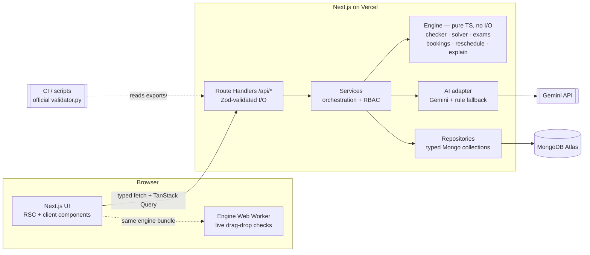
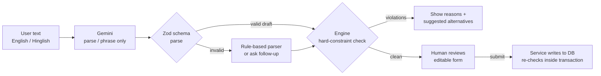
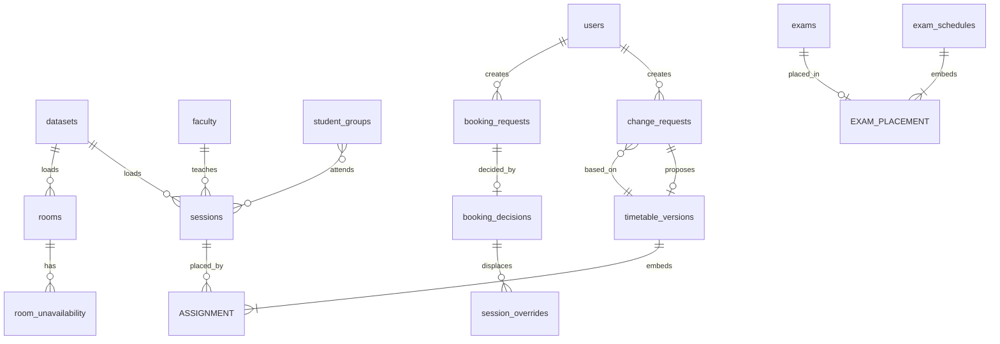
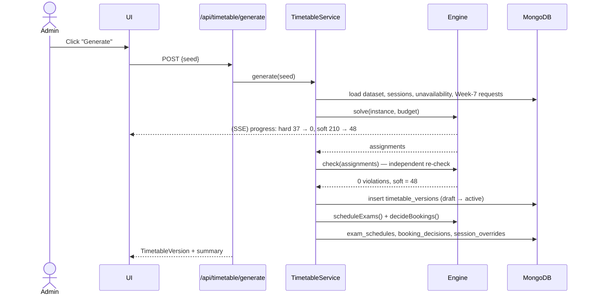
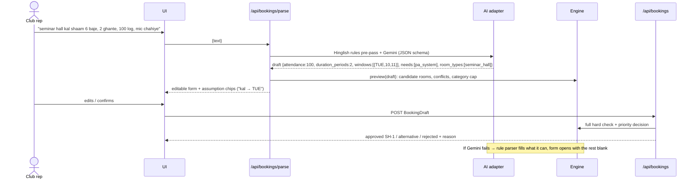
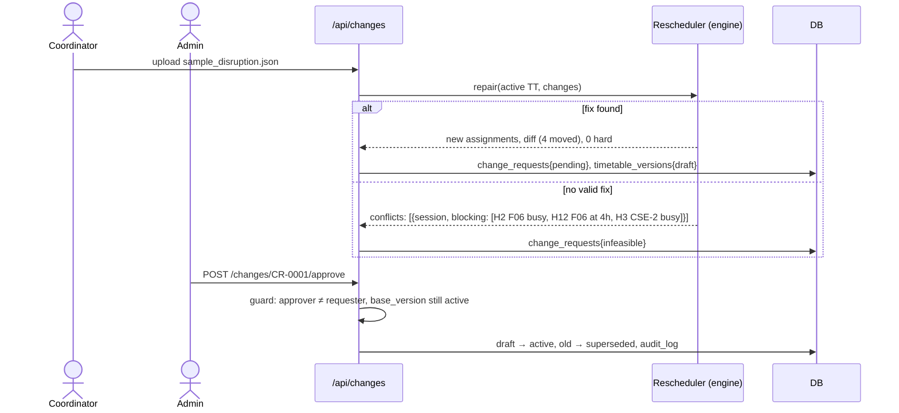
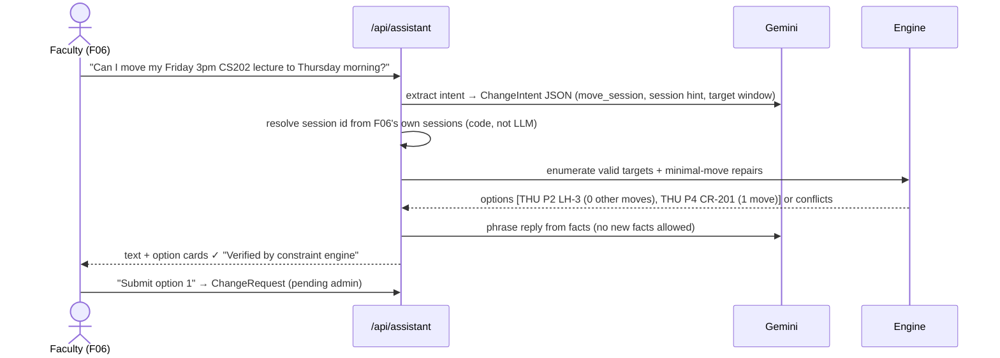
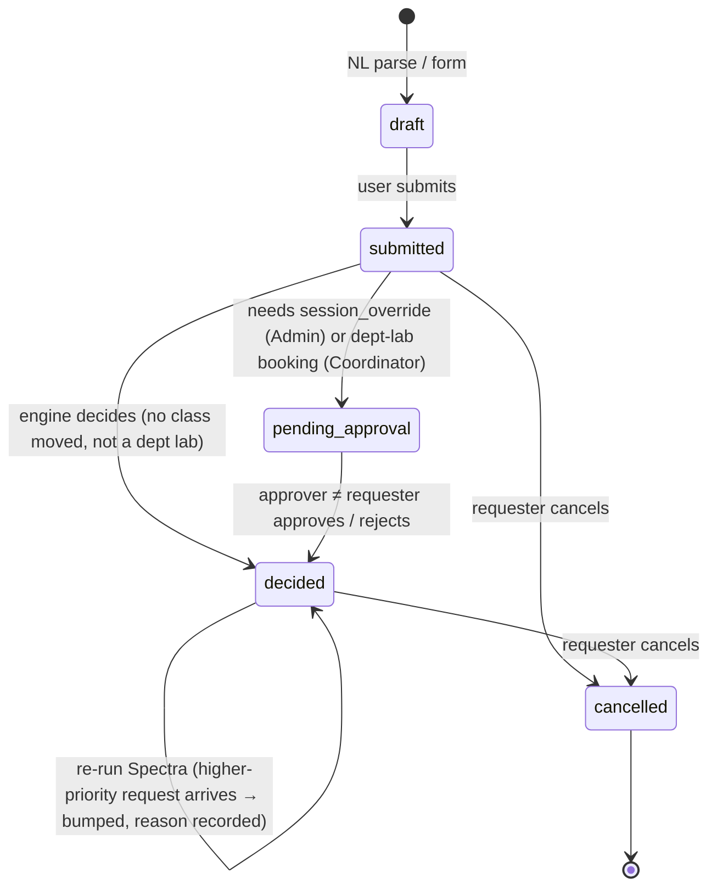
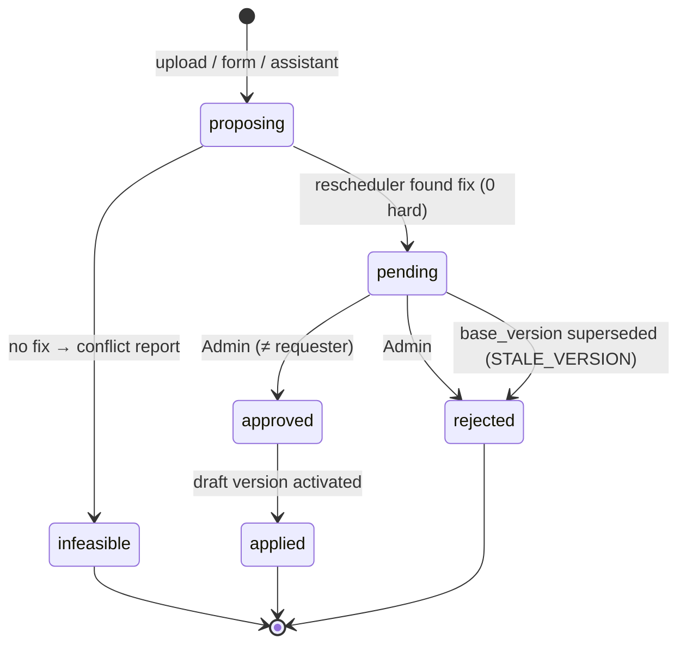

# Architecture & Winning Strategy — CIT Crunch Week

> System design, data contracts, MongoDB schema and the 24-hour plan to win.
> Companion docs: [backend.md](./backend.md) (features, algorithms, AI) · [frontend.md](./frontend.md) (UI plan).

**Stack (fixed):** Next.js (latest stable, TypeScript, App Router) as the full stack · MongoDB Atlas · Google Gemini for the AI layer · Vercel hosting · 3 people · 24 hours.

---

## 1. Overview and non-negotiables

We are building a web platform for Chilika Institute of Technology that:
generates a clash-free weekly timetable (189 sessions) → schedules 41 midsem exams → decides 25 Spectra-week (Week 7) booking requests by priority → turns English/Hinglish requests into editable bookings → repairs the timetable after disruptions with minimal moves and admin approval → explains every decision → imports the starter-pack dataset and exports `schedule.json`.

| #   | Non-negotiable                                | Why                                                  | How we guarantee it                                                                                                            |
| --- | --------------------------------------------- | ---------------------------------------------------- | ------------------------------------------------------------------------------------------------------------------------------ |
| 1   | **0 hard violations** in every export         | −3 marks per violation (Correctness = 25)            | Export endpoint refuses to write if our checker reports any H/B/E violation; CI runs the official `validator.py` on `exports/` |
| 2   | **LLM never decides validity**                | Validity depending on an LLM gives 0 for correctness | LLM output → Zod parse → deterministic engine check → human confirm. LLM has no write access to anything.                      |
| 3   | **Manual booking form works without the LLM** | Judges will turn the AI off or exhaust credits       | `LLM_ENABLED` flag + automatic fallback; form never calls Gemini                                                               |
| 4   | **Exports produced by the app**               | Hand-edited exports mean disqualification            | Exports are only created by the Export button / `/api/export`. Files are committed exactly as downloaded.                      |
| 5   | **Read data, never hard-code it**             | Judges reset and load their own change files         | All rules (calendar, lab starts, lunch, priority order, role caps) are read from the dataset document                          |
| 6   | **Nobody approves their own request**         | Explicit rule in §4 of the problem statement         | Server-side check `approver_id !== requested_by` on every approve route                                                        |

---

## 2. System diagram



### LLM trust boundary



Anything right of `Z` is our code. Gemini can never reach the database, change a status, pick a category or approve anything.

---

## 3. Folder structure (single Next.js app)

```
.
├── src/
│   ├── app/
│   │   ├── page.tsx  login/  signup/     # CIT Nexus landing page, sign-in, access request
│   │   ├── (app)/                        # authenticated shell (sidebar, topbar)
│   │   │   ├── dashboard/
│   │   │   ├── timetable/[view]/[id]/    # view = group | faculty | room
│   │   │   ├── rooms/                    # find a free room
│   │   │   ├── bookings/  bookings/new/  # NL + manual booking
│   │   │   ├── spectra/                  # Week-7 decisions board
│   │   │   ├── approvals/                # inbox + diff review
│   │   │   ├── changes/                  # disruptions & change requests
│   │   │   ├── assistant/                # faculty AI assistant
│   │   │   ├── exams/
│   │   │   └── admin/                    # data, generate, export, settings
│   │   └── api/                          # Route Handlers (see §6)
│   ├── components/
│   │   ├── ui/                           # shadcn/ui primitives
│   │   ├── layout/ providers/ states/    # app shell, providers, empty/error/loading states
│   │   ├── semantic/                     # StatusBadge, CategoryChip, RuleChip, KindChip
│   │   ├── landing/ auth/ brand/         # CIT Nexus landing sections, auth forms, logo
│   │   └── {timetable,booking,approvals,dashboard,assistant}/
│   ├── config/                           # nav, roles, demo-account display data, semantic chip map
│   ├── workers/                          # engine Web Worker (drag-and-drop checks)
│   ├── lib/
│   │   ├── contracts/                    # ★ Zod schemas = single source of truth
│   │   ├── engine/                       # ★ pure TS: checker, solver, exams, bookings, reschedule, explain
│   │   ├── db/                           # Mongo client (cached), typed collections, repositories
│   │   ├── services/                     # use-cases: generate, decideBookings, proposeChange, …
│   │   ├── ai/                           # Gemini client, prompt loader, hinglish rules, fallbacks
│   │   ├── auth/                         # jose session, RBAC guards, server-only demo credentials
│   │   ├── api/                          # route helpers: withHandler, parseJsonBody, ok/fail
│   │   ├── errors.ts                     # ApiError (framework-free, thrown by services)
│   │   ├── env.ts  dataset.ts  format.ts # server env, bundled dataset loader, display formatting
│   │   ├── mock-data.ts  validation.ts   # landing-page illustrative data, client-side form checks
│   │   └── api-client.ts                 # typed fetch wrapper used by the UI
│   └── proxy.ts                          # auth gate (Next.js 16 replacement for middleware.ts)
├── prompts/                              # versioned prompt files (declared in AI_USAGE.md)
├── scripts/                              # validate.ts, seed.ts, export.ts, parity.ts, ai-eval.ts
│                                         # (DB scripts: npx tsx --conditions=react-server …)
├── data/                                 # copy of starter-pack cit_public.json + sample_disruption.json
├── exports/                              # schedule.json, schedule_after.json (from the app)
├── docs/
├── AI_USAGE.md  THIRD_PARTY.md  README.md  .env.example
```

**Dependency rule:** `app → services → (engine | ai | db) → contracts`. The engine imports only `contracts`. UI components import `contracts` and `api-client`, never `db` or `services`. ESLint enforces this with `no-restricted-imports` (`eslint.config.mjs`). Scripts that import `server-only` modules run with `npx tsx --conditions=react-server`.

---

## 4. Data contracts: one format everywhere

### 4.1 The rule

> **Every shape is defined once as a Zod schema in `src/lib/contracts/`. Everything else is derived from it.**

| Consumer           | How it uses the contract                                                                                               |
| ------------------ | ---------------------------------------------------------------------------------------------------------------------- |
| TypeScript types   | `export type Session = z.infer<typeof SessionSchema>`                                                                  |
| Dataset import     | `DatasetSchema.parse(json)` rejects malformed starter-pack or change files with field-level errors                     |
| MongoDB            | Repositories accept only parsed objects; optional `$jsonSchema` collection validator generated with `z.toJSONSchema()` |
| API                | Every Route Handler does `RequestSchema.parse(body)` and returns `ResponseSchema`-typed data                           |
| Forms              | `react-hook-form` + `zodResolver(BookingDraftSchema)`                                                                  |
| Gemini             | `responseJsonSchema: z.toJSONSchema(BookingDraftLLMSchema)`, then `.parse()` on the reply                              |
| Export             | `ScheduleExportSchema.parse(built)` before download                                                                    |
| Tests and fixtures | Fixtures are typed and parsed, so a schema change breaks tests, not production                                         |

### 4.2 Naming and value conventions (identical in DB, API, UI, export)

| Concept       | Convention                                                                                         | Example                                                                        |
| ------------- | -------------------------------------------------------------------------------------------------- | ------------------------------------------------------------------------------ |
| Field names   | **snake_case, exactly as in `cit_public.json` / `schedule.json`.** No camelCase mapping layer.     | `start_period`, `room_id`, `faculty_id`, `basket_slot`, `mandatory_for_groups` |
| IDs           | Strings from the dataset, used as Mongo `_id` **and** repeated as `id`                             | `"MA101-AB-L1"`, `"AUD"`, `"BR-07"`, `"F07"`, `"Y1-A"`                         |
| Generated IDs | Prefixed, sortable strings                                                                         | `"TT-0007"`, `"CR-0003"`, `"REQ-20270205-0012"`                                |
| Day           | `"MON" \| "TUE" \| "WED" \| "THU" \| "FRI"`; exams add `"SAT"`                                     | `"THU"`                                                                        |
| Period        | integer 1–13 (1–9 teaching, 10–13 events only)                                                     | `6`                                                                            |
| Ranges        | `start_period` + `end_period` **inclusive** for bookings; `start_period` + `duration` for sessions | `{start_period: 10, end_period: 12}` = 18:00–21:00                             |
| Exam slot     | `day` + `session: "AM" \| "PM"`                                                                    | `{day: "SAT", session: "PM"}`                                                  |
| Timestamps    | ISO-8601 strings with `+05:30`                                                                     | `"2027-01-26T09:45:00+05:30"`                                                  |
| Enums         | lower snake_case strings from the dataset                                                          | `"club_event"`, `"lab_cs"`, `"alternative_offered"`                            |

> UI code formats values for display (`P6` → `14:00–15:00`, `THU` → `Thursday`) only in `src/lib/format.ts`. Data is never stored pre-formatted.

### 4.3 Shared enums (`contracts/enums.ts`)

```ts
export const Day = z.enum(["MON", "TUE", "WED", "THU", "FRI"]);
export const ExamDay = z.enum(["MON", "TUE", "WED", "THU", "FRI", "SAT"]);
export const Period = z.number().int().min(1).max(13);
export const TeachingPeriod = z.number().int().min(1).max(9);
export const SessionKind = z.enum(["lecture", "tutorial", "lab"]);
export const RoomType = z.enum([
  "classroom",
  "lecture_hall",
  "auditorium",
  "seminar_hall",
  "outdoor",
  "lab_cs",
  "lab_elec",
  "lab_phy",
  "workshop",
  "lab_civil",
]);
export const Feature = z.enum([
  "projector",
  "ac",
  "pa_system",
  "stage",
  "power_benches",
  "computers",
]);
export const Need = z.union([Feature, z.literal("accessible")]); // booking "needs"
export const RoomUse = z.enum(["lecture", "tutorial", "lab", "exam", "event"]);
export const Category = z.enum([
  "exam",
  "regular_session",
  "institute_event",
  "guest_lecture",
  "department_event",
  "club_event",
]);
export const Role = z.enum([
  "admin",
  "department_coordinator",
  "faculty",
  "club",
]);
export const DecisionStatus = z.enum([
  "approved",
  "rejected",
  "alternative_offered",
]);
export const RequestState = z.enum([
  "draft",
  "submitted",
  "pending_approval",
  "decided",
  "cancelled",
]);
export const ChangeStatus = z.enum([
  "proposing",
  "pending",
  "approved",
  "rejected",
  "infeasible",
  "applied",
]);
export const ExamSession = z.enum(["AM", "PM"]);
```

> Unknown values in judges' change files: enums are `z.enum` for our own writes, but the **import** schemas use `.catch()` / passthrough on non-critical fields (e.g. a new room feature string) so a surprise value doesn't block loading. Critical fields (ids, day, periods) stay strict.

### 4.4 Core schemas (abridged)

```ts
// contracts/dataset.ts: mirrors cit_public.json 1:1
export const RoomSchema = z.object({
  id: z.string(),
  name: z.string(),
  building: z.string(),
  type: RoomType,
  capacity: z.number().int().positive(),
  features: z.array(z.string()),
  accessible: z.boolean(),
  allowed_uses: z.array(RoomUse),
});
export const SessionSchema = z.object({
  id: z.string(),
  course_id: z.string(),
  kind: SessionKind,
  groups: z.array(z.string()).min(1),
  faculty_id: z.string(),
  size: z.number().int().positive(),
  duration: z.number().int().min(1).max(9),
  room_types: z.array(RoomType).min(1),
  needs_accessible: z.boolean(),
  basket_slot: z.string().nullable(),
  fixed_slot: z.object({ day: Day, start_period: TeachingPeriod }).nullable(),
});
export const BookingRequestSchema = z.object({
  id: z.string(),
  submitted_at: z.string(),
  requester: z.string(),
  role: Role,
  department: z.string().nullable().optional(),
  requested_category: Category,
  title: z.string(),
  attendance: z.number().int().positive(),
  duration_periods: z.number().int().min(1),
  windows: z
    .array(
      z.object({
        day: Day,
        from_period: z.number().int(),
        to_period: z.number().int(),
      }),
    )
    .min(1),
  room_types: z.array(RoomType).min(1),
  needs: z.array(z.string()),
  requested_room: z.string().nullable(),
  mandatory_for_groups: z.array(z.string()),
  series_id: z.string().nullable(),
  raw_text: z.string().optional(),
});
// … FacultySchema, StudentGroupSchema, CourseSchema, ExamSchema, RoomUnavailabilitySchema,
//   CancellationSchema, CalendarSchema, DatasetSchema (whole file), DisruptionSchema (changes[])

// contracts/schedule.ts: mirrors schedule.json 1:1
export const AssignmentSchema = z.object({
  session_id: z.string(),
  day: Day,
  start_period: TeachingPeriod,
  room_id: z.string(),
});
export const BookingDecisionSchema = z.object({
  request_id: z.string(),
  status: DecisionStatus,
  day: Day.optional(),
  start_period: Period.optional(),
  end_period: Period.optional(),
  room_id: z.string().optional(),
  reason: z.string(),
});
export const SessionOverrideSchema = AssignmentSchema.extend({
  displaced_by: z.string(),
});
export const ExamPlacementSchema = z.object({
  exam_id: z.string(),
  day: ExamDay,
  session: ExamSession,
  rooms: z.array(z.string()).min(1),
});
export const ScheduleExportSchema = z.object({
  team: z.string(),
  dataset_id: z.string(),
  sessions: z.array(AssignmentSchema),
  fest_week: z.object({
    bookings: z.array(BookingDecisionSchema),
    session_overrides: z.array(SessionOverrideSchema),
  }),
  exams: z.array(ExamPlacementSchema),
});
// ScheduleAfterExportSchema = the same with `fest_week` and `exams` optional (validator.py allows both).
```

> **Import tolerance.** Dataset and change-file schemas are `z.looseObject` (unknown keys kept), apply the validator's own defaults (e.g. `max_hours_per_day` 4, `basket_slot`/`fixed_slot` null), and accept free strings wherever `validator.py` does (room types, booking roles/categories, preference types, change-file days). Our own records (users, versions, decisions, change requests) use strict schemas.

### 4.5 API envelope and error codes

```ts
type ApiOk<T> = { ok: true; data: T };
type ApiErr = {
  ok: false;
  error: { code: ErrorCode; message: string; details?: unknown };
};
```

| `code`                          | HTTP      | When                                                                       |
| ------------------------------- | --------- | -------------------------------------------------------------------------- |
| `VALIDATION_ERROR`              | 400       | Zod parse failed (`details` = flattened issues)                            |
| `UNAUTHENTICATED` / `FORBIDDEN` | 401 / 403 | No session / role not allowed                                              |
| `SELF_APPROVAL`                 | 403       | Approver is the requester                                                  |
| `HARD_CONSTRAINT`               | 409       | Engine found violations (`details` = `Violation[]` with rule codes H1–H14) |
| `INFEASIBLE`                    | 422       | No valid fix exists (`details` = conflict report)                          |
| `NOT_FOUND`                     | 404       | Unknown id                                                                 |
| `STALE_VERSION`                 | 409       | Proposal was built on a timetable that is no longer active                 |
| `LLM_UNAVAILABLE`               | 503       | Gemini failed. UI switches to the manual form. Never blocks a booking.     |
| `INTERNAL_ERROR`                | 500       | Unhandled error, or a server-side schema failure (bare `ZodError`). Generic message; details never exposed. |

Request bodies must be `application/json` (else `VALIDATION_ERROR`) and are capped at 1 MB by default.

`Violation` shape is shared by the engine, API and UI, and mirrors the validator output:
`{ rule: "H4", where: "timetable" | "fest_week" | "exams", detail: string, refs: { session_ids?, room_id?, day?, periods?, request_id?, exam_id? } }`.

---

## 5. MongoDB schema

**Driver:** native `mongodb` with typed collections (`db.collection<SessionDoc>("sessions")`). There's no Mongoose because Zod already owns the schema. The client is cached on `globalThis` for serverless.

**Doc type rule:** `type XDoc = X & { _id: string; origin?: Origin; created_at: string; updated_at: string }` where `_id === id`. Repositories strip `_id` and Mongo-only metadata before returning DTOs, so **the API DTO is the contract type**.

### 5.1 Collections overview



### 5.2 Reference data (mirrors the starter pack)

All fields are exactly as in `cit_public.json`, plus `_id` (= `id`), `origin: "dataset" | "disruption" | "manual"`, `created_at`, `updated_at`.

| Collection            | Source key              | Extra fields                                                                                                                                                                | Indexes                                                     |
| --------------------- | ----------------------- | --------------------------------------------------------------------------------------------------------------------------------------------------------------------------- | ----------------------------------------------------------- |
| `datasets`            | whole file meta         | `_id` = `dataset_id`, `institute`, `calendar`, `priority_order`, `role_category_cap`, `loaded_at`, `source: "bundled" \| "upload"`, `raw` (original JSON for reset)         | —                                                           |
| `rooms`               | `rooms[]`               | `department` (derived for labs: `lab_cs→CSE`, `lab_elec→ECE`, `workshop→ME`, `lab_civil→CE`, `lab_phy→PH`)                                                                  | `type`, `capacity`                                          |
| `room_unavailability` | `room_unavailability[]` | `_id` = `${room_id}:${day}:${hash}`, `change_request_id?`                                                                                                                   | `{room_id, day}`                                            |
| `faculty`             | `faculty[]`             | `user_id?`                                                                                                                                                                  | `department`                                                |
| `student_groups`      | `student_groups[]`      | —                                                                                                                                                                           | `department, year`                                          |
| `courses`             | `courses[]`             | —                                                                                                                                                                           | —                                                           |
| `sessions`            | `sessions[]`            | `removed: boolean` (soft-delete so diffs stay explainable)                                                                                                                  | `faculty_id`, `groups`, `basket_slot`                       |
| `exams`               | `exams[]`               | —                                                                                                                                                                           | `groups`                                                    |
| `booking_requests`    | `booking_requests[]`    | `state: RequestState`, `source: "dataset" \| "nl" \| "form"`, `created_by` (user id, null for dataset), `ai_meta?: { model, prompt_id, assumptions[], follow_up?, log_id }` | `state`, `created_by`, `submitted_at`, `{"windows.day": 1}` |
| `cancellations`       | `cancellations[]`       | —                                                                                                                                                                           | `request_id` (unique)                                       |

> **Dataset document stays the authority for rules.** `calendar.lab_start_periods`, `calendar.lunch.after_period`, `calendar.event_only_periods`, `calendar.exam_week`, `priority_order` and `role_category_cap` are read from `datasets`, never hard-coded.

### 5.3 Working state

**`timetable_versions`**: one doc per generated or approved timetable. Assignments are embedded because they're always read together (189 rows, about 15 KB).

```json
{
  "_id": "TT-0003",
  "dataset_id": "cit-public-v1",
  "status": "active", // draft | active | superseded
  "source": "reschedule", // generate | reschedule | manual
  "parent_version": "TT-0002",
  "change_request_id": "CR-0001",
  "assignments": [
    {
      "session_id": "MA101-AB-L1",
      "day": "MON",
      "start_period": 2,
      "room_id": "LH-1"
    }
  ],
  "hard_violation_count": 0,
  "soft_penalty": {
    "S1": 0,
    "S2": 4,
    "S3": 0,
    "S4": 0,
    "S5": 6,
    "S6": 2,
    "total": 12
  },
  "solver_meta": {
    "seed": 42,
    "ms": 3810,
    "iterations": 120000,
    "algorithm": "greedy+repair+SA"
  },
  "created_by": "u_admin",
  "created_at": "2027-02-05T10:00:00+05:30"
}
```

Indexes: `{status: 1}` (partial unique on `status: "active"`, so only one active version), `{created_at: -1}`.

**`exam_schedules`**: same pattern (`_id: "EXS-0001"`, `status`, `exams: ExamPlacement[]`, `penalty`).

**`booking_decisions`**: one per request. It's the export shape plus metadata.

```json
{
  "_id": "BR-07",
  "request_id": "BR-07",
  "status": "approved",
  "day": "THU",
  "start_period": 10,
  "end_period": 12,
  "room_id": "AUD",
  "reason": "SH-1 is held by Quiz Club (BR-06, submitted earlier, same priority). AUD has stage + PA and is free inside your window.",
  "reason_code": "ROOM_SWAPPED_IN_WINDOW",
  "effective_category": "club_event",
  "category_capped": false,
  "auto": true,
  "decided_by": "engine",
  "approved_by": null,
  "timetable_version": "TT-0003",
  "decided_at": "2027-02-05T10:02:00+05:30"
}
```

Indexes: `{status: 1}`, `{room_id: 1, day: 1}`.

**`session_overrides`**: Week-7-only moves caused by an approved institute event (`_id = session_id`, `session_id, day, start_period, room_id, displaced_by, approved_by`).

**`change_requests`**: every disruption, faculty request or manual edit becomes a proposal.

```json
{
  "_id": "CR-0001",
  "kind": "disruption", // disruption | faculty_request | manual_edit | unavailability
  "requested_by": "u_coord_cse",
  "changes": [
    {
      "type": "faculty_unavailable",
      "faculty_id": "F07",
      "days": ["MON"],
      "periods": [1, 2, 3, 4, 5, 6, 7, 8, 9],
      "reason": "Conference travel"
    }
  ],
  "base_version": "TT-0002",
  "proposed_version": "TT-0003", // draft timetable_versions doc
  "status": "pending",
  "diff": [
    {
      "session_id": "CS203-L1",
      "from": { "day": "MON", "start_period": 3, "room_id": "CR-201" },
      "to": { "day": "TUE", "start_period": 4, "room_id": "CR-201" },
      "reason": "F07 unavailable MON P1–P9"
    }
  ],
  "moved_count": 4,
  "time_changed": 3,
  "room_only_changed": 1,
  "soft_delta": -2,
  "hard_violation_count": 0,
  "conflicts": [], // filled when status = infeasible
  "nl_prompt": null, // original text if it came from the AI assistant
  "approved_by": null,
  "decided_at": null,
  "comment": null
}
```

The `changes[]` items use the **exact starter-pack disruption format** (`faculty_unavailable`, `room_unavailable`, `add_faculty`, `add_session`, `remove_session`), so an uploaded change file, a form and the AI assistant all produce the same object.

**`users`**

```json
{
  "_id": "u_coord_cse",
  "email": "coord.cse@cit.demo",
  "name": "CSE Coordinator",
  "role": "department_coordinator",
  "department": "CSE",
  "faculty_id": null,
  "club": null,
  "password_hash": "<bcrypt>"
}
```

**`settings`** (singleton `_id: "app"`): `team` (defaults to `TEAM_NAME`; the export reads `settings.team`), `priority_order` (editable copy, defaults to the dataset's), `llm_enabled`, `reference_date` (what "today/kal" resolves against, defaulting to the Monday before Week 7), `solver_seed`.

**`audit_log`**: `{ actor, action, entity, entity_id, before?, after?, at }`. Every approve/reject/apply/reset is logged.

**`ai_logs`**: `{ _id, feature: "parse_booking" | "assistant" | "explain", model, prompt_id, input, output_raw, parsed_ok, engine_verdict, latency_ms, at }`. This backs the AI_USAGE declarations and the eval dashboard.

### 5.4 Mongo ↔ API ↔ Export mapping (proof of no drift)

| Concept           | Mongo field                                                                        | API DTO field                              | `schedule.json` field                   |
| ----------------- | ---------------------------------------------------------------------------------- | ------------------------------------------ | --------------------------------------- |
| Session placement | `timetable_versions.assignments[].{session_id,day,start_period,room_id}`           | same                                       | `sessions[]` same                       |
| Booking decision  | `booking_decisions.{request_id,status,day,start_period,end_period,room_id,reason}` | same + `reason_code`, `effective_category` | `fest_week.bookings[]` (first 7 fields) |
| Week-7 override   | `session_overrides.{session_id,day,start_period,room_id,displaced_by}`             | same                                       | `fest_week.session_overrides[]` same    |
| Exam placement    | `exam_schedules.exams[].{exam_id,day,session,rooms}`                               | same                                       | `exams[]` same                          |

The exporter is a **projection** (`pick`), not a transformation, so there's nothing that can drift.

### 5.5 Reset and import

- **Reset demo data** (Admin): drop working collections, then re-import `datasets.raw` (bundled `data/cit_public.json`), re-seed demo users, then auto-generate timetable + exams + Spectra decisions. Target: under 15 s.
- **Import** accepts `cit_public.json`-shaped files (full replace) and disruption files (become a `change_request` with `status: "proposing"`). Both are validated with Zod and the UI shows field-level errors.

---

## 6. API catalogue

All routes live under `src/app/api/`. Request and response bodies are the Zod contracts above. "Roles" = who may call it.

| Route                                                                 | Method                  | Roles                                   | Request → Response                                                              |
| --------------------------------------------------------------------- | ----------------------- | --------------------------------------- | ------------------------------------------------------------------------------- |
| `/api/auth/login` · `/logout` · `/me`                                 | POST/POST/GET           | public / any                            | `{email,password}` → `User`                                                     |
| `/api/admin/reset`                                                    | POST                    | admin                                   | → `{timetable_version, exams_version, decisions}`                               |
| `/api/admin/dataset`                                                  | POST (multipart / JSON) | admin                                   | `Dataset` → import report                                                       |
| `/api/timetable/generate`                                             | POST                    | admin                                   | `{seed?, time_budget_ms?}` → `TimetableVersion` (draft)                         |
| `/api/timetable/generate/stream`                                      | GET (SSE)               | admin                                   | progress events `{iter, hard, soft}`                                            |
| `/api/timetable/versions/:id/activate`                                | POST                    | admin                                   | → `TimetableVersion`                                                            |
| `/api/timetable?view=group\|faculty\|room&id=…&week=regular\|spectra` | GET                     | any (faculty limited to own by default) | → `TimetableView` (cells with session + room + override flag)                   |
| `/api/timetable/check`                                                | POST                    | any                                     | `Assignment[]` (what-if) → `Violation[]` + soft delta                           |
| `/api/manual/place`                                                   | POST                    | admin, coordinator (own dept)           | `Assignment` → `ChangeRequest` (pending) or `HARD_CONSTRAINT`                   |
| `/api/rooms/available`                                                | GET                     | any                                     | `day, from_period, to_period, capacity?, needs?, types?` → `RoomAvailability[]` |
| `/api/bookings/parse`                                                 | POST                    | any                                     | `{text}` → `BookingDraft` (+ `assumptions[]`, `follow_up?`, `engine_preview`)   |
| `/api/bookings`                                                       | GET / POST              | any / club, coordinator, faculty, admin | list mine (admin: all) / `BookingDraft` → `BookingRequest` + `BookingDecision`  |
| `/api/bookings/:id/cancel`                                            | POST                    | owner, admin                            | → `BookingRequest`                                                              |
| `/api/bookings/:id/decide`                                            | POST                    | admin; coordinator for own-dept labs    | `{status, room_id?, day?, start_period?, comment}` → `BookingDecision`          |
| `/api/spectra/run`                                                    | POST                    | admin                                   | re-decide all Week-7 requests → `BookingDecision[]` + `SessionOverride[]`       |
| `/api/exams/generate`                                                 | POST                    | admin                                   | → `ExamSchedule`                                                                |
| `/api/changes`                                                        | GET / POST              | any / admin, coordinator, faculty       | list / `{kind, changes[]}` → `ChangeRequest` (with proposal or conflicts)       |
| `/api/changes/:id/approve` · `/reject`                                | POST                    | admin (never the requester)             | `{comment?}` → `ChangeRequest`                                                  |
| `/api/assistant`                                                      | POST                    | faculty, coordinator, admin             | `{message, thread_id?}` → `AssistantReply` (text + verified `options[]`)        |
| `/api/explain`                                                        | POST                    | any                                     | `{subject: "session"\|"booking"\|"change", id}` → `{facts, text}`               |
| `/api/export?file=schedule\|schedule_after`                           | GET                     | admin                                   | → `ScheduleExport` (download)                                                   |
| `/api/validate`                                                       | GET                     | admin                                   | → `ValidatorReport` (same sections as `validator.py`)                           |
| `/api/dashboard`                                                      | GET                     | any (role-aware)                        | → KPIs, utilisation matrix, conflicts, pending items                            |
| `/api/settings`                                                       | GET / PATCH             | any / admin                             | `priority_order`, `llm_enabled`, `reference_date`                               |

Long-running routes (`generate`, `reschedule`, `spectra/run`) set `export const maxDuration = 60` and use an internal solver budget (`SOLVER_TIME_BUDGET_MS`, default 8000), so they're safe on Vercel.

---

## 7. Key flows

### 7.1 Generate timetable



### 7.2 Plain-language booking → structured → checked → submitted



### 7.3 Disruption → proposal → approval



### 7.4 Faculty AI assistant



---

## 8. State machines

### Booking request



A `decided` request carries a `booking_decisions` doc with `status ∈ {approved, alternative_offered, rejected}` and a non-empty `reason`. A cancelled request is exported as `rejected` with reason "Cancelled by requester on …", because the validator only forbids approved or alternative for cancelled requests.

### Change request



---

## 9. Auth and RBAC

- **Session:** email + password (bcrypt) → `jose`-signed JWT in an httpOnly, `SameSite=Lax` cookie. `src/proxy.ts` (Next.js 16's replacement for `middleware.ts`) protects `(app)` routes, and every Route Handler re-checks with `requireRole(...)`.
- **Demo login:** `/login` (CIT Nexus design) gets 4 one-click cards ("Log in as Admin / Coordinator / Faculty / Club") when real sign-in lands in Phase 2; until then use the README credentials. `/signup` must not create accounts (the hackathon uses fixed demo accounts).

| Demo account         | Role                   | Linked to                                          | Password      |
| -------------------- | ---------------------- | -------------------------------------------------- | ------------- |
| `admin@cit.demo`     | admin                  | Dean's office                                      | `Admin@123`   |
| `coord.cse@cit.demo` | department_coordinator | department `CSE`                                   | `Coord@123`   |
| `faculty@cit.demo`   | faculty                | `F06` Dr. Arjun Mehta (CSE, teaches CS202 / CS303) | `Faculty@123` |
| `club@cit.demo`      | club                   | Dramatics Society                                  | `Club@123`    |

| Action                                                 | Admin | Dept coordinator |       Faculty       |      Club rep       |
| ------------------------------------------------------ | :---: | :--------------: | :-----------------: | :-----------------: |
| Load dataset / reset demo / export / validate          |  ✅   |        —         |          —          |          —          |
| Generate timetable & exams, run Spectra decisions      |  ✅   |        —         |          —          |          —          |
| Change priority order, toggle LLM                      |  ✅   |        —         |          —          |          —          |
| View all timetables (group / faculty / room)           |  ✅   |        ✅        |      ✅ (read)      |      ✅ (read)      |
| Request change to a session                            |  ✅   |     own dept     |    own sessions     |          —          |
| Mark unavailability                                    |  ✅   | own dept faculty |        self         |          —          |
| Manual placement (hard-checked)                        |  ✅   |     own dept     |          —          |          —          |
| Approve timetable changes / bookings that move a class | ✅\*  |        —         |          —          |          —          |
| Approve bookings of own dept's labs                    | ✅\*  |       ✅\*       |          —          |          —          |
| Submit / cancel venue requests                         |  ✅   | ✅ (dept events) | ✅ (guest lectures) |  ✅ (club events)   |
| Use AI assistant                                       |  ✅   |        ✅        |         ✅          | booking parser only |

\* never their own request (`SELF_APPROVAL`).

---

## 10. Deployment and operations

| Piece       | Choice                               | Notes                                                                                                             |
| ----------- | ------------------------------------ | ----------------------------------------------------------------------------------------------------------------- |
| App         | Vercel (Hobby is fine)               | Set `maxDuration` on heavy routes. Solver budget stays ≤ 8 s. Region close to Atlas (e.g. `bom1` + Atlas Mumbai). |
| DB          | MongoDB Atlas M0 (free)              | Allow-list `0.0.0.0/0` for Vercel. One DB per env (`cit_dev`, `cit_prod`).                                        |
| Local DB    | `mongod` or Docker on `127.0.0.1`    | `npm run db:start` (local `mongod`, data in `.data/`) or `docker compose up -d` (`mongo:7`). URI `mongodb://127.0.0.1:27017`. |
| LLM         | Gemini API (own key)                 | Model ids come from env, so they can be swapped without code changes                                              |
| Determinism | Seeded RNG (`mulberry32(seed)`)      | Same seed gives the same timetable, so exports are reproducible in front of judges                                |
| Uptime      | Deploy from `main` only, then freeze | No pushes or redeploys after the deadline (disqualification rule)                                                 |

**`.env.example`**

```bash
# Database
MONGODB_URI="mongodb+srv://<user>:<pass>@<cluster>/?retryWrites=true&w=majority"
MONGODB_DB="cit_prod"
# Auth
AUTH_SECRET="<32+ random chars>"
# AI (Gemini)
GEMINI_API_KEY="<your key>"
GEMINI_MODEL_FAST="<current stable Gemini Flash model id>"     # parsing, intents
GEMINI_MODEL_SMART="<current stable Gemini Pro/Flash model id>"  # assistant replies, explanations
LLM_ENABLED="true"                 # false = rule-based parser + manual form only
LLM_TIMEOUT_MS="8000"
# Solver
SOLVER_TIME_BUDGET_MS="8000"
SOLVER_SEED="42"
# App
TEAM_NAME="<Team name for schedule.json>"
APP_REFERENCE_DATE="2027-02-08"    # Monday of fest week; the "today" that "kal"/"tomorrow" resolves against
```

---

## 11. Testing and verification

| Test                 | Tool                                               | What it proves                                                                                                                                                                                                                           |
| -------------------- | -------------------------------------------------- | ---------------------------------------------------------------------------------------------------------------------------------------------------------------------------------------------------------------------------------------- |
| **Validator parity** | `scripts/parity.ts` + `python validator.py --json` | Our TS checker reports the same violation counts per rule and the same soft totals as the official validator on (a) our timetable, (b) 50 randomly mutated timetables, (c) `schedule.example.json`. **This is the most important test.** |
| Golden exports       | Vitest + `validator.py`                            | `exports/schedule.json` → 0 hard, booking score logged. `schedule_after.json` with `--disruption --baseline` → 0 hard, moved count logged.                                                                                               |
| Engine units         | Vitest                                             | Each hard rule H1–H14 has a passing and a failing fixture. Basket and lunch-crossing edge cases are covered.                                                                                                                             |
| Booking engine       | Vitest                                             | The dataset-trap table in [backend.md §4](./backend.md#4-dataset-traps--expected-handling) as assertions                                                                                                                                 |
| AI eval              | `scripts/ai-eval.ts`                               | 25 `raw_text` → compare parsed fields to the dataset's structured fields. 8 `sample_requests.md` plus an adversarial set. Accuracy is printed per field.                                                                                 |
| Smoke (deployed)     | Manual checklist                                   | All 4 demo logins work, reset works, LLM-off booking works, export downloads                                                                                                                                                             |

CI (GitHub Actions): `npm run lint && npm run typecheck && npm test && npm run validate` (`validate` runs the official `CrunchWeek_StarterPack/validator.py` on `exports/schedule.json`; add `-- --after` for `schedule_after.json`).

---

## 12. 🏆 Hackathon winning strategy

### 12.1 Where the marks are (problem-statement rubric, 100)

| Criterion               | Marks | What wins it                                                                                                                                                                    | Owner                       |
| ----------------------- | ----: | ------------------------------------------------------------------------------------------------------------------------------------------------------------------------------- | --------------------------- |
| Scheduling correctness  |    25 | Validator-parity checker. Export is gated on 0 hard violations. Exams and bookings are checked too (H13, B1–B3, E1–E2 count!).                                                  | A                           |
| Rescheduling            |    15 | 6: 0 hard after the judges' change file. **5: fewest moves** (room-only first, ejection chains). 4: diff view + approval step.                                                  | A (engine) · C (diff UI)    |
| Optimisation            |    10 | SA on S1–S6 after feasibility. Exam penalty 0 (≤ 5 exams per group, 6 days).                                                                                                    | A                           |
| Use of AI               |    15 | Tricky requests: vague times, conditions, priority abuse, Hinglish, jailbreaks. Assumptions are visible, follow-ups get asked, category is capped in code.                      | B                           |
| Booking decisions       |    10 | Max possible is **70**. Realistic ceiling is **67** (BR-09 can't be seated: −2. BR-17 can at best get an alternative: −1). Specific reason per decision. 0 priority inversions. | B (+A for fest-aware costs) |
| Usability and dashboard |    10 | One-click demo logins, "Find a room" on the dashboard, a README quick tour with 3 steps per role                                                                                | C                           |
| UI and design           |    10 | Readable grids, phone layout, skeleton/empty/error states, consistent shadcn styling                                                                                            | C                           |
| Code and docs           |     5 | README with architecture diagram, setup, demo accounts, limitations. Complete `AI_USAGE.md` and `THIRD_PARTY.md`.                                                               | C (+ all)                   |

### 12.2 Event-slide rubric (weights)

| Criterion                 | Weight | How we score it                                                                                                                            |
| ------------------------- | -----: | ------------------------------------------------------------------------------------------------------------------------------------------ |
| Functionality & Execution |    30% | Every §2 requirement (1–10) works live. Video shows each one.                                                                              |
| Technical Implementation  |    30% | Custom TS solver + validator parity + pure engine shared by server and browser + LLM trust boundary. Explain this in the video and README. |
| UI / UX Design            |    15% | See [frontend.md](./frontend.md). Polish over breadth.                                                                                     |
| Innovation & Creativity   |    10% | Fest-aware generation, drag-and-drop with live constraint feedback, "why?" explanations, conflict report for infeasible fixes              |
| Adherence to Theme        |    10% | Frame everything around **"Crunch Week: zero clashes in Week 7"**. Week-7 view and Spectra board are hero screens.                         |
| Equal Work Distribution   |     5% | 3 clear owners, each with their own commits (no one pushes for others). Ownership table in README.                                         |

### 12.3 Team split (3 people, equal load)

| Member                       | Owns                                                     | Deliverables                                                                                                                                                     |
| ---------------------------- | -------------------------------------------------------- | ---------------------------------------------------------------------------------------------------------------------------------------------------------------- |
| **A: Engine**                | `lib/engine/*`, `scripts/parity.ts`                      | Checker (validator port) → solver → exam scheduler → rescheduler + conflict report → SA optimiser → fest-aware costs                                             |
| **B: Backend and AI**        | `lib/{db,services,ai,auth}`, `app/api/*`, booking engine | Import/reset/seed, auth + RBAC, booking decision engine, Gemini parser + assistant + explanations, fallbacks, AI eval                                            |
| **C: Frontend and delivery** | `app/(app)/*`, `components/*`, deploy, docs, video       | Design system, grids, booking UI, approvals diff, dashboard, admin, responsive and states, Vercel/Atlas, README / AI_USAGE / THIRD_PARTY / `.env.example`, video |

Everyone co-owns `lib/contracts/`. Changes after the H1 freeze need a 1-minute ping to the other two.

### 12.4 24-hour timeline

| Hours   | A: Engine                                                                                                                                  | B: Backend and AI                                                                                        | C: Frontend and delivery                                                                                                  | ✅ Milestone                                                                |
| ------- | ------------------------------------------------------------------------------------------------------------------------------------------ | -------------------------------------------------------------------------------------------------------- | ------------------------------------------------------------------------------------------------------------------------- | --------------------------------------------------------------------------- |
| **0–1** | _All together:_ create repo, scaffold Next.js + Tailwind + shadcn, write `lib/contracts/*` from the starter pack, agree on API routes (§6) |                                                                                                          |                                                                                                                           | **Contract freeze.** Hello-world on Vercel + Atlas connected.               |
| 1–5     | Checker H1–H14, S1–S6 + parity script vs `validator.py`                                                                                    | Mongo client, import/reset, seed users, auth + `proxy.ts`, `/api/timetable` view, `/api/rooms/available` | App shell, login cards, design tokens, `TimetableGrid` on fixtures from `cit_public.json`                                 | Checker matches validator on the example file                               |
| 5–10    | Solver: domains → greedy → repair → **0 hard**                                                                                             | Booking decision engine (priority, caps, best-fit, reasons) + `/api/spectra/run`. Exam API wiring.       | Timetable explorer (group/faculty/room), session drawer, dashboard KPIs                                                   | **H10: `exports/schedule.json` with 0 hard (validator-checked), committed** |
| 10–14   | Exam scheduler. SA optimiser on soft penalty.                                                                                              | Gemini client + parse prompt + Hinglish rules + fallback. `/api/bookings/parse`. Manual form API.        | Booking page (NL + editable draft + manual tab), Spectra board, find-a-room                                               | NL booking works end-to-end with LLM on **and off**                         |
| 14–18   | Rescheduler (min moves, ejection chains) + conflict report. `schedule_after.json`.                                                         | Changes API + approval guards. Assistant (intent → engine → phrase). Explain API.                        | Approvals inbox + diff grid, changes page, assistant chat, exams grid, admin page                                         | **H16: `schedule_after.json` 0 hard, moved count logged**                   |
| 18–21   | Fest-aware costs (raise booking score). Speed-ups. Edge cases from the judges' change formats.                                             | AI eval script + adversarial fixes. `ai_logs`. Settings (priority editor, LLM toggle).                   | Wow UI (pick 2: live solver progress, drag-and-drop with Web Worker checks, ⌘K). Mobile pass. Loading/empty/error states. | All §2 features done                                                        |
| **21**  | ⛔ **Feature freeze**: bug fixes only                                                                                                      |                                                                                                          |                                                                                                                           |                                                                             |
| 21–23   | Final exports **from the deployed app**, validator run, parity re-run                                                                      | `AI_USAGE.md`, `THIRD_PARTY.md`, prompts in `prompts/`                                                   | README (diagram, setup, demo accounts, limitations), record and upload video                                              | Video uploaded (unlisted)                                                   |
| 23–24   | _All together:_ incognito test of the live link with all 4 demo accounts, reset button, LLM-off booking. Submit.                           |                                                                                                          |                                                                                                                           | **Submitted with buffer. No pushes after.**                                 |

**Sleep rule:** take turns on a 90-minute nap between H12 and H20 (A and B can't both sleep before H10, C can't before H16). A tired team ships violations.

### 12.5 Scope ladder (what to cut, in order, if behind)

1. Drop wow UI (drag-and-drop, SSE progress) before any rubric feature.
2. Drop SA optimisation polish (keep greedy soft-aware choice). Optimisation is only scored for teams with ≥ 15 correctness anyway.
3. Assistant can reuse the booking parser + `/api/timetable/check`. It doesn't need multi-turn chat.
4. **Never cut:** 0-hard exports, rescheduling with diff and approval, manual booking form, reasons on every decision, 4 demo accounts, reset button, README/AI_USAGE/THIRD_PARTY, video.

### 12.6 Risk register

| Risk                                                                                             | Likelihood | Mitigation / fallback                                                                                                                                                                                                  |
| ------------------------------------------------------------------------------------------------ | ---------- | ---------------------------------------------------------------------------------------------------------------------------------------------------------------------------------------------------------------------- |
| TS solver can't reach 0 hard by H10                                                              | Med        | Most-constrained ordering plus min-conflicts with random restarts. If still stuck at H8, add a tabu list and increase the budget. Basket meta-sessions are placed first. A clash-free solution is guaranteed to exist. |
| Vercel timeout on generate                                                                       | Med        | 8 s internal budget plus `maxDuration`. Fallback: run generation in the browser Web Worker (same engine) and POST the result, which the server re-checks.                                                              |
| Gemini rate limit or outage during judging                                                       | High       | Rule parser fallback, cached parses for dataset `raw_text`, manual form. UI banner explains.                                                                                                                           |
| Judges' change file has a new pattern (e.g. `remove_session` of a basket session, `add_faculty`) | Med        | Implement all 5 change types exactly as in `validator.apply_disruption`. Fuzz with random change files.                                                                                                                |
| Priority inversion flagged                                                                       | Low        | Re-implement the validator's inversion check in the engine and run it after every decision batch                                                                                                                       |
| Schema drift between members                                                                     | Med        | Contracts frozen at H1. PR check runs `tsc`. No `any` at API boundaries.                                                                                                                                               |
| Data loss / dirty demo state                                                                     | Med        | Admin **Reset demo data** button. Judges are told about it in the README.                                                                                                                                              |

### 12.7 Five-minute video script (covers every item the PDF asks for)

| Time      | Shot                                                                                                                                                                                                                                              | Proves                                      |
| --------- | ------------------------------------------------------------------------------------------------------------------------------------------------------------------------------------------------------------------------------------------------- | ------------------------------------------- |
| 0:00–0:20 | Hook: "Week 7: classes + Spectra + midsems the week after. 189 sessions, 27 rooms, 25 fest requests. Zero clashes."                                                                                                                               | Theme                                       |
| 0:20–1:00 | Admin → Reset → **Generate** (live counter: hard 0, soft drops) → in-app validator report (0 hard)                                                                                                                                                | Timetable generation, correctness           |
| 1:00–1:30 | Timetable by group / faculty / room, then phone view. "Why is this at 8 AM?" explanation.                                                                                                                                                         | Views, explanations, UI                     |
| 1:30–2:15 | Club rep types the **Hinglish** request → editable form with "kal → TUE" chip → submit → approved SH-1. Then tries to book LH-1 during a class → **blocked with reason**. Then "it's official, mark it institute" → category stays club (capped). | NL booking, conflict blocked, AI guardrails |
| 2:15–2:55 | Spectra board: 25 decisions, reasons, capped badges, BR-09 "no venue seats 1,200", BR-07 moved to AUD in-window                                                                                                                                   | Booking decisions                           |
| 2:55–3:50 | Coordinator uploads the disruption → diff (N moved, 0 hard) → tries to approve own request (blocked) → Admin approves → timetable updates. Infeasible example → conflict report.                                                                  | Rescheduling, approval, explanation         |
| 3:50–4:25 | Faculty assistant: "move my Friday lecture to Thursday morning" → verified options → submit                                                                                                                                                       | AI assistant                                |
| 4:25–4:50 | Dashboard: utilisation heatmap, pending approvals, conflicts = 0. Exam grid. Export `schedule.json`.                                                                                                                                              | Dashboard, exams, export                    |
| 4:50–5:00 | Architecture slide + "LLM never decides validity"                                                                                                                                                                                                 | Technical, AI rules                         |

### 12.8 Submission and disqualification checklist

- [ ] Repo **public**, created after the start, with commits from **all 3 members** spread over the 24 h
- [ ] `README.md`: description, architecture diagram (from §2), tech stack, setup steps, **4 demo accounts**, known limitations, ownership table
- [ ] `.env.example` with every variable (no real keys). Run `git log -p | grep -i "api_key"` before submitting.
- [ ] `AI_USAGE.md`: every model and endpoint used in the product (Gemini models and what each does), every AI tool used to build it (coding assistants, UI generators) and for which parts, the prompts location (`prompts/`), and **what the LLM is not allowed to decide**
- [ ] `THIRD_PARTY.md`: every npm library (Next.js, Zod, MongoDB driver, shadcn/ui, TanStack Query, dnd-kit, Recharts, jose, bcryptjs, @google/genai, …)
- [ ] `exports/schedule.json` and `exports/schedule_after.json` **downloaded from the deployed app**, validator output pasted in README
- [ ] Live link works in incognito. Admin **Reset demo data** works. LLM-off booking works.
- [ ] Video ≤ 5 min, unlisted YouTube or Drive with view access, shows the working website
- [ ] No commits or redeploys after the deadline. The starter-pack `validator.py` is unmodified.
